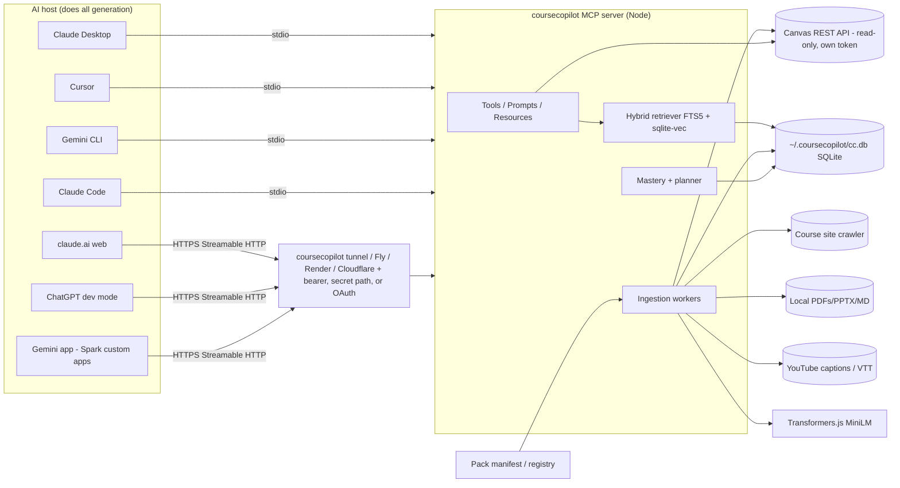

# CourseCopilot: Technical Prep Sheet (Build Spec v1)

> "Your classes inside the AI you already use, free. Share a course in one line."
> Positioning: course packs for your AI. Any course website (or your Canvas course) becomes a cited, quiz-tracking tutor in Claude, ChatGPT, Gemini, and Cursor that you can share with your class. Not "just another Canvas MCP" and not a "NotebookLM clone." (Revised Oct 13, 2026 after the competitive research in `coursecopilot-competitive-2026-10-13.md`. Revised again Oct 13, 2026: Canvas is back in v1, and every client must work before launch.)
> Repo: https://github.com/Verdent06/coursecopilot (MIT). Spec date: Oct 13, 2026. Audience: a Cursor cloud agent building it PR by PR, plus Vedant.
> Rule for this doc: anything we couldn't confirm is marked **[UNVERIFIED]**. Builders should check those items before relying on them.

---

## 0. TL;DR of decisions

| Decision | Choice |
|---|---|
| Form factor | A single **MCP server**. Your AI assistant (Claude, ChatGPT, Cursor, Gemini) does all the text generation. CourseCopilot never calls an LLM and needs **no API key**. |
| Language/SDK | **TypeScript on Node ≥ 20**, official MCP TS SDK **v2** (`@modelcontextprotocol/server`) |
| Storage | One local **SQLite** file: `better-sqlite3` + **FTS5** (keyword search) + **sqlite-vec** (vectors) |
| Embeddings | **Transformers.js** (`@huggingface/transformers`) running `Xenova/all-MiniLM-L6-v2` (384-dim, about 23 MB, downloaded once). Falls back to FTS-only if the model can't load. |
| Transports | **stdio** for local clients (Claude Desktop, Claude Code, Cursor, Gemini CLI). **Streamable HTTP** (`coursecopilot serve --http`) for claude.ai web/mobile, ChatGPT, and the Gemini app (Spark custom apps). Both ship before launch. |
| Install | `npx coursecopilot setup` detects **every local client it can find** (Claude Desktop, Claude Code, Cursor, Gemini CLI) and writes each config after backing it up. For web clients it prints the public URL to paste (or offers `--remote` to start a tunnel). `npx coursecopilot doctor` checks the install. Manual fallbacks: Cursor deeplink, Claude Desktop `.mcpb`, JSON snippets. |
| Client support | **All of these must work before launch:** Claude Desktop, claude.ai web, Claude Code, Cursor, ChatGPT (developer mode; plan-gated), Gemini CLI, and the Gemini app via Gemini Spark custom apps (eligibility-gated, §3.2). |
| Canvas (v1) | Read-only Canvas integration at canvas-mcp level: courses, files, modules, pages, assignments + due dates, announcements. Uses **your own personal access token**, local only. If the school blocks tokens, it fails gracefully and points to manual export / website / packs. Own milestone (M6), after crawler + YouTube and before launch. |
| Course packs (core v1) | A pack is a small JSON/YAML manifest: course id/name/term, source URLs, and a lecture → topic map. It contains **no copyrighted content**. `npx coursecopilot add-pack <id\|url\|path>` downloads the materials from their original sources onto your machine and builds the index. `export-pack` creates a pack from a local course. Public registry: `Verdent06/coursecopilot-packs`, with 10–20 starter packs for public courses. |
| Cut from v1 | Canvas writes, Canvas OAuth / multi-user hosting, Google AI Studio (no MCP client exists, §3.2), and polish on the exam planner. |
| Remote mode | **Required for launch** (M9), self-hosted. `coursecopilot serve --http` with a bearer token or secret URL path, made public through `coursecopilot tunnel` (Cloudflare quick tunnel) or a one-click deploy (Fly.io / Render / Cloudflare Containers templates). No central hosted service in v1. |

---

## 1. Problem and target user

**Problem.** A student's course material is scattered across a professor's custom website (for example UMich EECS 376 runs its own site, not Canvas), Canvas modules, PDFs, slide decks, and lecture videos. General AI assistants don't know any of it, so their answers are generic and come without citations. NotebookLM can ground answers in your files, but you have to upload everything by hand, it lives in its own app, and it isn't open source. Students already have Claude or ChatGPT open. They want "explain the pumping lemma *the way Lecture 7 did it*, with the slide number," plus quizzes built from that material and a plan for the week before the exam.

**Primary user.** A university student (CS/STEM first) who uses Claude (Desktop, web, or Code), ChatGPT, Gemini (app or CLI), or Cursor weekly and takes 3–5 courses a term.
**Secondary user.** A student who has already indexed a course and wants to share it with classmates (`export-pack` → PR to the registry → classmates run `add-pack eecs376-f26`). Also TAs and instructors who want to publish an official pack for their public course site.

**The "damn I wish I had that" moment:** run one line (`npx coursecopilot add-pack mit-6.045`), then ask "quiz me on what I missed" and get questions that cite "Lec 9 slide 12."

---

## 2. v1 scope vs out of scope

**In scope (v1)**
- **Course packs** (§9.7): `add-pack` / `export-pack` / `list-packs` from the CLI and as MCP tools, a public registry repo with a JSON schema and validation CI, and 10–20 starter packs.
- **Auto-setup for every local client**: `coursecopilot setup` detects and configures Claude Desktop, Claude Code, Cursor, and Gemini CLI (backing up each config first). For web clients (claude.ai, ChatGPT, Gemini app) it prints the exact URL and click path. `coursecopilot doctor` checks every detected client (§12).
- Add a course. Ingest from: (a) a public course website URL (crawled within limits), (b) local PDFs/PPTX/Markdown/TXT files and folders, (c) YouTube links (captions only), (d) VTT/SRT transcripts, (e) **Canvas** (see below).
- **Canvas integration (read-only, canvas-mcp-level)** (§3.6, §9.2): list active courses; ingest and search files, modules, pages, front page, assignment descriptions, and announcements; expose assignments with due dates and announcements as live tools. Personal access token from env or a 0600 secrets file. If tokens are blocked or rejected, it fails gracefully with a clear message and fallback paths.
- Hybrid search (keyword + vector) with citations to page, slide, URL anchor, timestamp, or Canvas item.
- Quiz support. The server hands back source chunks and a quiz scaffold, the host AI writes the questions, and the server records attempts.
- Topic extraction (heuristic) and weak-spot tracking per topic.
- Basic exam study plan data: topics ranked by weakness × exam weight × how close the exam is. Ship the deterministic algorithm in §11 and nothing more. Planner polish is deferred. Canvas assignment due dates can seed exams (suggested, never auto-set).
- MCP prompts and resources (Section 7).
- **Remote/HTTP mode before launch** (§13): Streamable HTTP, auth, a built-in tunnel command, and one-click deploy templates, so claude.ai, ChatGPT, and the Gemini app work at launch.
- **Client compatibility matrix**: a documented, smoke-tested status for each of the 7 client surfaces before launch.

**Explicitly out of scope (v1)**
- Calling any LLM API, or hosting a model.
- A multi-tenant hosted SaaS, user accounts, or Canvas OAuth developer keys. Canvas's own docs say multi-user apps must use OAuth; v1 is single-user and self-run.
- **Writing anything to Canvas** (submissions, discussion posts, messages). Grades are also out (not needed for studying, and more sensitive).
- Accepting Canvas tokens on any server someone else runs. In remote mode the token stays in the self-hosted server's env; on one-click deploys it's the user's own instance.
- Local Whisper transcription of uploaded audio/video. It is planned for v1.1 as an opt-in extra (Section 9.5).
- Logging in to sites (Piazza, Gradescope, sites behind SSO), or scraping anything that needs auth other than the Canvas API with the user's own token.
- A GUI or web dashboard, mobile apps, flashcard spaced-repetition scheduling (v2), and ChatGPT Apps SDK custom UI widgets (v2).
- Google AI Studio support (it has no MCP client as of Oct 2026; §3.2) and Gemini Enterprise admin setup (documented only, not tested).
- Redistributing course content in packs. Packs hold links and metadata only. **Canvas sources are never exported into packs** (`export-pack` drops them with a warning).

---

## 3. Research summary (Oct 2026), with sources

### 3.1 MCP itself
- The current spec revision is **2026-07-28**. Streamable HTTP is now POST-only to a single endpoint. Every request must carry an `MCP-Protocol-Version` header that matches `_meta`, and sessions/GET streams were removed in this revision ([spec, Streamable HTTP](https://mcp-staging.mintlify.app/specification/2026-07-28/basic/transports/streamable-http)). *Note: that link is a staging mirror. Builders should confirm against modelcontextprotocol.io/specification/latest.* **[UNVERIFIED on the canonical site]**
- **TS SDK v2** (`@modelcontextprotocol/server`, `/client`, plus `/node`, `/express`, `/hono` adapters) is the stable line for the 2026-07-28 spec. v1 (`@modelcontextprotocol/sdk`) gets fixes for at least 6 months after 2026-07-27 ([typescript-sdk](https://github.com/modelcontextprotocol/typescript-sdk)).
- **Python SDK v2** (`pip install mcp`) supports stdio, Streamable HTTP, and SSE ([python-sdk](https://github.com/modelcontextprotocol/python-sdk)).
- OpenAI's docs still name `@modelcontextprotocol/sdk` ([OpenAI build MCP server](https://developers.openai.com/plugins/build/mcp-server)). Both work. We use v2 and test against ChatGPT, claude.ai, and the Gemini app in remote mode (M9, then the full matrix in M12, both before launch), because client support for the new revision may lag **[UNVERIFIED]**. If ChatGPT or Claude reject 2026-07-28, fall back to SDK v1.x. The transport layer sits behind one adapter file so this swap stays cheap.

### 3.2 How each client installs servers today
| Client | Mechanism | Local stdio? | Source |
|---|---|---|---|
| Claude Desktop | `claude_desktop_config.json` `mcpServers`, or a `.mcpb` bundle (a zip with `manifest.json`). Install it by double-clicking, or via Settings → Extensions → Advanced → Install Extension | Yes | [Claude MCPB docs](https://claude.com/docs/connectors/building/mcpb), [Help Center](https://support.claude.com/en/articles/10949351-getting-started-with-local-mcp-servers-on-claude-desktop) |
| claude.ai web / mobile / Cowork | Custom connector: Customize → Connectors → Add → Custom → Web → paste URL. **Anthropic's cloud** connects to it, so it must be publicly reachable. Free plan allows 1 custom connector | No (remote only) | [Help Center](https://support.claude.com/en/articles/11176164-use-connectors-to-extend-claude-s-capabilities), [remote MCP](https://support.claude.com/en/articles/11175166-get-started-with-custom-connectors-using-remote-mcp) |
| ChatGPT | Developer mode → Plugins → "Add custom MCP server" → URL, or Secure MCP Tunnel. Supports SSE and streaming HTTP; auth can be OAuth or none. **Remote only.** **Pro: read/fetch tools only; full MCP (write actions) is Business/Enterprise/Edu** | No (remote, or OpenAI tunnel) | [OpenAI Help](https://help.openai.com/en/articles/12584461-developer-mode-and-mcp-apps-in-chatgpt), [custom MCP server](https://developers.openai.com/api/docs/guides/custom-mcp-server), [Secure MCP Tunnel](https://developers.openai.com/api/docs/guides/secure-mcp-tunnels.md) |
| Cursor | `~/.cursor/mcp.json` or `.cursor/mcp.json`, or deeplink `cursor://anysphere.cursor-deeplink/mcp/install?name=$NAME&config=$BASE64` | Yes | [Cursor install links](https://cursor.com/docs/mcp/install-links), [Cursor MCP help](https://cursor.com/help/customization/mcp.md) |
| Claude Code | `claude mcp add [-s user] coursecopilot -- npx -y coursecopilot@latest` (writes `~/.claude.json`); `--transport http <url>` for remote | Yes | Claude Code docs **[verify flags in M10]** |
| Gemini CLI | `gemini mcp add [-s user] <name> <cmd> [args]` writes to `~/.gemini/settings.json`; `-t http` for URLs | Yes | [Gemini CLI MCP docs](https://geminicli.com/docs/tools/mcp-server/) |
| **Gemini app (gemini.google.com + mobile)** | **Yes, as of Oct 2026, but only inside Gemini Spark.** Settings & help → Connected Apps → "Custom apps for Spark" → Add a custom app → paste the MCP server URL. If the server doesn't support Dynamic Client Registration, enter credentials under "Advanced features." Must be added on the web; then works in Spark on web and mobile. **Gates:** Gemini Spark access, personal Google account (not work/school, so not a umich.edu account), US, 18+, English only, Keep Activity on. Gemini asks for manual confirmation on write actions. Remote only | No (remote only) | [Gemini Help: custom apps for Spark](https://support.google.com/gemini/answer/17209137?co=GENIE.Platform%3DDesktop&hl=en), [Connected Apps](https://support.google.com/gemini/answer/13695044?hl=en-gb) |
| Gemini Enterprise | Admin-only "custom MCP server data store" in Google Cloud console. HTTPS URL, **Streamable HTTP only (SSE rejected)** | No (remote, admin) | [Gemini Enterprise docs](https://docs.cloud.google.com/gemini/enterprise/docs/connectors/custom-mcp-server/set-up-custom-mcp-server) |
| Google AI Studio | **No MCP client** as of Oct 2026. Only open feature requests on the developer forum. Not supported; point users to Gemini CLI or the Gemini app | n/a | [AI Studio forum feature request](https://discuss.ai.google.dev/t/feature-request-native-mcp-client-support-via-sse-http-tunnels-in-google-ai-studio/180380) |

**Best available Gemini path (decision):** (1) **Gemini CLI** is the primary, fully supported Gemini path: local stdio, configured automatically by `setup`, no eligibility gates. (2) **Gemini app via Spark custom apps** is the consumer path: needs remote mode (M9) and the user must meet Google's gates; README says so plainly. (3) Gemini Enterprise is documented as "ask your admin." (4) AI Studio is listed as unsupported. Note: a third-party compatibility matrix checked in July 2026 still said the consumer Gemini app had no custom connectors ([calmara.app](https://calmara.app/mcp-compatibility)), so the Spark feature looks new and US-only. **[UNVERIFIED: whether Spark accepts no-auth / secret-path URLs or requires OAuth with DCR; test in M12. If OAuth is required, the Gemini app path depends on the single-user OAuth server, which then moves into M9.]**

Plan/eligibility caveats:
- **ChatGPT plan gating:** developer mode / custom MCP connectors are plan-gated. We did not confirm access on Free/Plus. **[UNVERIFIED]** The README must say "ChatGPT support needs a plan with developer mode. Check OpenAI's page." The M12 matrix records exactly which plan the tester used and which tools were available.
- **Gemini app gating:** Spark access, US, 18+, personal account, English, Keep Activity on (see table). Students signed in with a school Google account can't use it; they should use Gemini CLI.
- The Help Center states Pro is limited to read/fetch. We don't know exactly how ChatGPT classifies a tool as "write" **[UNVERIFIED]**. We assume it uses MCP tool annotations (`readOnlyHint`). So we mark retrieval tools `readOnlyHint: true`, and design so the core value (cited Q&A, quiz generation) works with read-only tools alone. Recording quiz results is a write tool and may be unavailable on Pro.
- Anthropic says MCPB directory submissions are deprecated; you distribute the `.mcpb` file yourself ([MCPB docs](https://claude.com/docs/connectors/building/mcpb)). Claude Desktop ships a Node runtime for Node-based MCPB extensions **[UNVERIFIED; check the MCPB manifest spec `server.type: "node"`]**, which is one more reason to choose TS.

### 3.3 npx vs uvx
Both are one line. **npx wins for us** because Cursor/Claude users most often already have Node, Cursor's own docs use `npx -y` as their example, MCPB supports Node bundles, and Transformers.js plus sqlite-vec both ship npm packages. uvx needs `uv` installed first, which is one more step for most students.

### 3.4 Local embeddings, no API key
| Option | Notes | Weight |
|---|---|---|
| **Transformers.js + all-MiniLM-L6-v2 (chosen)** | Runs ONNX in Node, 384-dim vectors ([HF model card](https://huggingface.co/Xenova/all-MiniLM-L6-v2)) | Model about 23 MB, downloaded on first use and cached ([example repo](https://github.com/vahidkowsari/pi-local-rag/blob/main/__tests__/embedding.test.ts)); onnxruntime-node native binary adds tens of MB **[UNVERIFIED exact size]** |
| fastembed (Python/Rust) | Good quality, but it's Python-first, which conflicts with the TS choice | |
| **sqlite-vec (chosen)** | SQLite extension with an npm package; loads into better-sqlite3 | Small (single native lib, about 1 MB-ish **[UNVERIFIED]**) |
| LanceDB | Strong, but a heavier native dependency, and it's overkill for under 100k chunks per user | Heavier |
| Fallback | FTS5 BM25 only, if the vec or ONNX native load fails (some ARM/Windows edge cases) | 0 |

Possible upgrade: `bge-small-en-v1.5` (also 384-dim) for better retrieval quality. It's a config switch, and the default stays MiniLM.

### 3.5 Transcription
- **YouTube captions (v1).** Fetch the existing caption track (manual first, auto-generated second) and keep the timestamps. Use an npm caption-fetcher library or `yt-dlp --write-auto-subs --skip-download` if it's installed. YouTube changes its internals often and caption scraping breaks periodically **[risk]**. Wrap it behind an interface and fall back to yt-dlp.
- **Local Whisper (v1.1, opt-in).** whisper.cpp via an npm binding, or call `whisper`/`faster-whisper` if the user has it installed. Too heavy (models are hundreds of MB, plus ffmpeg) to be a default dependency.
- **User-supplied transcripts** (`.vtt`/`.srt`, e.g. Canvas/Kaltura/Panopto exports): parse them with timestamps in v1. This is cheap and covers lecture capture systems we can't log in to.

### 3.6 Canvas API token flow (v1, milestone M6)
- A student creates a token at **Canvas → Account → Settings → Approved Integrations → "+ New Access Token"**, then sets `CANVAS_BASE_URL` (e.g. `https://umich.instructure.com`) and `CANVAS_TOKEN`. The API also exposes token creation via `POST /api/v1/users/:user_id/tokens` ([Canvas access tokens](https://documentation.instructure.com/doc/api/access_tokens.html)).
- **Policy caveat:** Canvas docs say asking other users to manually generate a token for your application violates the API policy, and multi-user apps MUST use OAuth ([Canvas OAuth2](https://documentation.instructure.com/doc/api/file.oauth.html)). Our framing: CourseCopilot is software *you* run locally with *your own* token, not a service that collects tokens. We never accept Canvas tokens in hosted mode run by someone else. Some schools disable student tokens **[risk]**. Expect that: `canvas connect` detects the failure (no "New Access Token" button, 401/403 on `/users/self`) and prints a graceful fallback: use the course website, a pack, or download files and add them as a folder.
- **Setup:** `coursecopilot canvas connect` asks for the base URL and token, validates it, and stores it in env/`~/.coursecopilot/secrets.json` (0600). The token is never written to client configs, the DB, logs, or packs.
- Endpoints to use: `GET /api/v1/courses?enrollment_state=active`, `/courses/:id/modules?include[]=items`, `/courses/:id/pages`, `/pages/:url`, `/courses/:id/files` (may be 403 for students; if so, get files via module items), `/courses/:id/assignments`, `/courses/:id/front_page`, `/courses/:id/assignment_groups` (for exam weights), `/courses/:id/assignments?bucket=upcoming` and `/users/self/upcoming_events` (due dates), `/announcements?context_codes[]=course_:id` (announcements). Capability target is parity with canvas-mcp's student read tools (courses, files, modules, pages, assignments + due dates, announcements), read-only. Follow `Link: rel="next"` for pagination and respect `X-Rate-Limit-Remaining`.

### 3.7 Crawling course sites
- Honor `robots.txt` (use the `robots-parser` npm package) with UA `CourseCopilot/<ver> (+repo URL)`.
- Same-origin and path-prefix scope by default (e.g. everything under `https://eecs376.org/`). Max depth 3, max 300 pages, concurrency 2, and at least 500 ms between requests per host.
- Follow linked PDFs/PPTX even if they're one hop off-origin (e.g. Google Drive direct links, a GitHub raw link), but don't crawl further from them.
- Skip `mailto:`, calendars, `.zip`, video files, and anything that looks like a login page (has a password input, or redirects to an SSO host). Report those as "skipped: requires login."
- JS-rendered sites: v1 uses static HTML only. If a page yields under 200 chars of text, flag it "may need JS rendering." Optional Playwright support is planned for v1.1.
- Content-hash every fetched document (sha256) so re-syncs are incremental. Use ETag/Last-Modified when available.

### 3.8 Competitors and the real gap (updated Oct 13, 2026; details and sources in `coursecopilot-competitive-2026-10-13.md`)
- **BetterCampus (formerly BetterCanvas):** a browser extension for Canvas, Blackboard, Brightspace, Moodle, and Google Classroom with study sets, quizzes, and chat with files. Free tier: 3 AI items/mo. Pro: $19/mo or $119/yr. Claims 2M+ students. It runs inside its own extension, not your AI.
- **NotebookLM:** free. Grounded Q&A, quizzes, and flashcards with "retry only missed cards," plus lecture recording and video overviews. It is a separate app with manual upload, and it tracks missed cards per deck, not weak concepts across a course.
- **CourseMCP (indie):** a Chrome extension that indexes a **Canvas** course down to the page/slide level and exposes it over MCP. **This is the closest direct competitor.** It is Canvas-only and has no shareable packs.
- **canvas-mcp ([vishalsachdev/canvas-mcp](https://github.com/vishalsachdev/canvas-mcp), ~290★)** and other Canvas MCP servers (mcp-canvas-lms ~103★, others ~12★): API wrappers for one LMS covering assignments, grades, and files. Canvas wrappers top out at a few hundred stars. **We now match their read capability in v1**, so Canvas users don't need a second server, but Canvas is a feature, not the pitch: what they lack is citations into indexed content, quizzes/weak spots, packs, and non-Canvas sources.
- **open-notebook ([lfnovo/open-notebook](https://github.com/lfnovo/open-notebook), ~40k★):** a self-hosted NotebookLM alternative. It shows that open-source "NotebookLM for X" projects can reach tens of thousands of stars, but it is a separate app with no course structure or quiz tracking.
- Others: ChatGPT Study Mode / Projects (5 files on Free), Claude Projects (limited by context), Turbo AI ($20/mo, 10M users), and official school AI (IgniteAI, Claude Canvas LTI), which needs an admin and is Canvas-only.
- **The gap CourseCopilot fills:** (1) **shareable course packs**, so one student indexes a course and the whole class reuses it in one line (nobody offers this); (2) **courses that aren't on Canvas**, like custom course sites, YouTube lectures, and PDFs; (3) **precise citations** (page/slide/timestamp); (4) **weak-spot tracking by concept** that carries across sessions and assistants; (5) free, local, no API key, and auto-setup so non-developers never edit JSON.

---

## 4. Recommended stack (and why)

**Pick: TypeScript / Node 20+.**
- npx is the lowest-friction install for our audience, and Claude Desktop MCPB supports Node.
- The first-party TS SDK v2 tracks the newest spec.
- Transformers.js plus sqlite-vec give us local embeddings with no Python.
- One language for CLI, server, and tests.

**Tradeoffs we accept:**
- Native modules (`better-sqlite3`, `sqlite-vec`, `onnxruntime-node`) can fail on unusual platforms. Mitigation: prebuilt binaries, a CI matrix, and graceful degradation to FTS-only.
- Python has better PDF/ASR libraries. Mitigation: `unpdf`/`pdfjs-dist` is good enough for text PDFs, and ASR is deferred.

**Libraries (pin major versions; verify current versions when starting M0):**
- MCP: `@modelcontextprotocol/server`, `@modelcontextprotocol/node` (HTTP), `zod` (schemas)
- Storage: `better-sqlite3`, `sqlite-vec`
- Embeddings: `@huggingface/transformers`
- PDF: `unpdf` (pdf.js-based; gives per-page text)
- PPTX: `jszip` + `fast-xml-parser` (read `ppt/slides/slideN.xml` and the notes slides)
- DOCX (nice to have): `mammoth`
- HTML: `undici` fetch, `cheerio`, `@mozilla/readability` + `linkedom`, then `turndown` to Markdown
- Crawl: `robots-parser`, `p-limit`
- Captions: a YouTube transcript library, with `yt-dlp` as an optional fallback; `@plussub/srt-vtt-parser` or a hand-written VTT parser
- CLI: `commander`
- Test: `vitest`, `@modelcontextprotocol/client` (for end-to-end), `msw` or a local static server for fixtures
- Lint/format: `biome` (one tool)

---

## 5. Architecture



**Key flows**
0. *Add pack:* `add-pack eecs376-f26` → resolve it from the registry index (or a URL/path) → validate against the schema → create the course → enqueue one `add_source` per URL in the manifest → apply the manifest's topic map (`set_topics` with origin `pack`) → ingest as in flow 1.
1. *Add source:* `add_source` → enqueue job → fetch → extract into segments with locators → chunk → embed → write to DB → job status `done`. Ingestion runs in-process on an async queue. Long jobs return a `job_id` right away so tool calls never block for minutes (clients time out). `get_ingest_status` polls the job.
2. *Ask:* the host calls `search_course` → gets the top-k chunks with citation objects → the host writes the answer and quotes the citations.
3. *Quiz:* `generate_quiz_context` returns chunks grouped by topic plus question-writing instructions → the host writes questions and grades the user's answers → `record_quiz_attempt` stores the results → mastery updates.
4. *Canvas live:* `canvas_list_assignments` / `canvas_list_announcements` call the Canvas API directly (short cache) so due dates are fresh; course content (pages, files, modules) is ingested into the index via `add_source(kind:'canvas')` and cited like any other source.
5. *Plan:* `get_study_plan` returns topics ranked with recommended sessions → the host formats the plan.

**Design principle: the host AI does generation.** The server only fetches, parses, indexes, retrieves, stores, and scores. No LLM SDKs appear in dependencies, and CI enforces this (a lint rule fails on `openai`, `@anthropic-ai/sdk`, `@google/genai`). The Canvas client is plain `undici` REST, not an LLM SDK. Where we need "intelligence" (topic labels, quiz questions, grading), we return structured context plus instructions, and the host writes back structured results through a tool (e.g. `set_topics`, `record_quiz_attempt`).

---

## 6. Data model (SQLite, `~/.coursecopilot/cc.db`, override with `COURSECOPILOT_HOME`)

```sql
CREATE TABLE courses(
  id TEXT PRIMARY KEY,            -- slug, e.g. "eecs376-f26"
  title TEXT NOT NULL,
  term TEXT,                      -- "F26"
  exam_dates_json TEXT DEFAULT '[]', -- [{"name":"Midterm","date":"2026-10-28","topics":["..."],"weight":0.25}]
  created_at TEXT, updated_at TEXT
);

CREATE TABLE sources(
  id TEXT PRIMARY KEY,            -- ulid
  course_id TEXT REFERENCES courses(id) ON DELETE CASCADE,
  kind TEXT CHECK(kind IN ('website','canvas','file','folder','youtube','transcript')),
  uri TEXT NOT NULL,              -- URL, canvas://course/123, file:///abs/path
  title TEXT,
  config_json TEXT,               -- crawl limits, canvas course id, etc. NEVER the token
  status TEXT CHECK(status IN ('queued','running','done','error','partial')),
  error TEXT,
  last_synced_at TEXT
);

CREATE TABLE documents(           -- one fetched unit: a page, a PDF, a deck, a video
  id TEXT PRIMARY KEY,
  source_id TEXT REFERENCES sources(id) ON DELETE CASCADE,
  course_id TEXT,
  url TEXT,                       -- canonical URL or file path
  title TEXT,
  mime TEXT,
  content_hash TEXT,              -- sha256 of raw bytes, for incremental sync
  fetched_at TEXT,
  meta_json TEXT                  -- {lecture_no, published_at, duration_s, page_count}
);

CREATE TABLE chunks(
  id INTEGER PRIMARY KEY,         -- rowid shared with vec + fts
  document_id TEXT REFERENCES documents(id) ON DELETE CASCADE,
  course_id TEXT,
  ord INTEGER,                    -- order within document
  text TEXT NOT NULL,
  locator_json TEXT NOT NULL,     -- see Citation format §10
  heading_path TEXT,              -- "Lecture 7 > Pumping Lemma > Proof"
  token_count INTEGER
);
CREATE VIRTUAL TABLE chunks_fts USING fts5(text, heading_path, content='chunks', content_rowid='id');
CREATE VIRTUAL TABLE chunks_vec USING vec0(embedding float[384]);

CREATE TABLE topics(
  id TEXT PRIMARY KEY,
  course_id TEXT,
  name TEXT,                      -- "Pumping lemma"
  origin TEXT CHECK(origin IN ('heuristic','host','user')),
  UNIQUE(course_id, name)
);
CREATE TABLE chunk_topics(chunk_id INTEGER, topic_id TEXT, weight REAL, PRIMARY KEY(chunk_id, topic_id));

CREATE TABLE quiz_attempts(
  id TEXT PRIMARY KEY,
  course_id TEXT,
  created_at TEXT,
  mode TEXT                       -- 'quiz','exam_sim','quick_check'
);
CREATE TABLE quiz_items(
  id TEXT PRIMARY KEY,
  attempt_id TEXT REFERENCES quiz_attempts(id) ON DELETE CASCADE,
  topic_id TEXT,
  question TEXT,
  user_answer TEXT,
  correct INTEGER CHECK(correct IN (0,1)),
  partial_credit REAL,            -- 0..1, host-graded
  difficulty INTEGER CHECK(difficulty BETWEEN 1 AND 3),
  confidence INTEGER,             -- optional self-report 1..3
  cited_chunk_ids TEXT            -- json array
);

CREATE TABLE topic_mastery(
  course_id TEXT, topic_id TEXT,
  alpha REAL DEFAULT 1, beta REAL DEFAULT 1,  -- Beta posterior
  last_seen_at TEXT, n_attempts INTEGER DEFAULT 0,
  PRIMARY KEY(course_id, topic_id)
);

CREATE TABLE jobs(id TEXT PRIMARY KEY, source_id TEXT, state TEXT, progress REAL, message TEXT, started_at TEXT, finished_at TEXT);
CREATE TABLE schema_version(v INTEGER);
```

**Pack migration (added in M2, after M1 ships; M1 itself stays unchanged):**
```sql
CREATE TABLE packs(
  id TEXT PRIMARY KEY,            -- "mit-6.045-s11"
  course_id TEXT REFERENCES courses(id) ON DELETE CASCADE,
  version TEXT,                   -- manifest semver
  origin TEXT,                    -- registry | url | path
  manifest_json TEXT NOT NULL,
  installed_at TEXT
);
-- topics.origin also accepts 'pack' (rebuild the CHECK constraint in the migration)
```

Secrets (Canvas, v1): the Canvas token comes from env `CANVAS_TOKEN`, or the OS keychain via `keytar` **[optional; keytar is archived (UNVERIFIED), so prefer env plus a 0600 file `~/.coursecopilot/secrets.json`]**. It is never stored in the DB or returned by any tool.

---

## 7. MCP surface

### 7.1 Conventions
- Every tool has a zod input schema, returns `structuredContent` (JSON) **and** a short text rendering for hosts that ignore structured output, and sets annotations: `readOnlyHint` (true for retrieval), `destructiveHint` (true for remove), `openWorldHint` (true for tools that fetch the web).
- Errors use `isError: true` with an actionable message, e.g. "Canvas returned 401. Your token may be expired. Create a new one at Account → Settings → Approved Integrations."
- `course_id` is optional on retrieval tools when there's only one course. Otherwise the error lists the valid ids.
- ChatGPT compatibility: also expose **`search`** and **`fetch`** tools with the shapes OpenAI documents for read-only/deep-research use **[UNVERIFIED exact required schema; check the current OpenAI MCP docs in M9]**. They're thin aliases over `search_course` and `get_chunk`.

### 7.2 Tools

| # | Name | RO? | Input | Output |
|---|---|---|---|---|
| 1 | `add_course` | no | `{title, term?, course_id?}` | `{course_id}` |
| 2 | `list_courses` | yes | `{}` | `[{course_id,title,term,source_count,chunk_count,exams}]` |
| 3 | `add_source` | no (openWorld) | `{course_id, kind:'website'\|'file'\|'folder'\|'youtube'\|'transcript'\|'canvas', uri (for canvas: `canvas://course/<id>`), options?:{max_depth?,max_pages?,include_prefix?,lecture_no?}}` | `{source_id, job_id, status:'queued'}` |
| 4 | `get_ingest_status` | yes | `{job_id? , course_id?}` | `[{job_id,source_id,state,progress,message,docs,chunks,skipped:[{url,reason}]}]` |
| 5 | `list_sources` | yes | `{course_id}` | `[{source_id,kind,uri,status,last_synced_at,doc_count}]` |
| 6 | `sync_course` | no | `{course_id, source_id?}` | `{job_ids}` (incremental re-fetch) |
| 7 | `remove_source` | destructive | `{source_id}` | `{removed_chunks}` |
| 8 | `canvas_list_courses` | yes (openWorld) | `{include_past?=false}` | `[{canvas_course_id, name, course_code, term, linked_course_id?}]`; returns `{error:'canvas_not_configured'\|'token_rejected'\|'tokens_blocked', fallback}` gracefully |
| 8a | `canvas_list_modules` | yes (openWorld) | `{canvas_course_id}` | `[{module, items:[{type,title,html_url,locked}]}]` |
| 8b | `canvas_list_files` / `canvas_list_pages` | yes (openWorld) | `{canvas_course_id, search?}` | `[{id,title,url,updated_at}]` (files falls back to module items on 403) |
| 8c | `canvas_get_page` | yes (openWorld) | `{canvas_course_id, page_url}` | `{title, body_markdown, html_url}` |
| 8d | `canvas_list_assignments` | yes (openWorld) | `{canvas_course_id?, upcoming_only?=true, days?=14}` | `[{name, due_at (ISO + user tz), points, submission_types, html_url, course}]` across all active courses if no id |
| 8e | `canvas_list_announcements` | yes (openWorld) | `{canvas_course_id?, since_days?=14}` | `[{title, posted_at, message_markdown, html_url}]` |
| 9 | `search_course` | yes | `{query, course_id?, k?=8 (max 20), source_kinds?, topic?}` | `{results:[{chunk_id,text,score,citation}]}` |
| 10 | `get_chunk` | yes | `{chunk_id, context?=1}` | `{chunk, neighbors:[...], citation}` |
| 11 | `get_course_outline` | yes | `{course_id}` | `{documents grouped by source, lectures in order, topics}` |
| 12 | `set_topics` | no | `{course_id, topics:[{name, chunk_ids?:[], keywords?:[]}]}` | `{topic_ids}`; lets the host label topics |
| 13 | `generate_quiz_context` | yes | `{course_id, topics?:[], n?=5, difficulty?:1-3, focus?:'weak'\|'all'\|'exam', exam_name?}` | `{items:[{topic, chunks:[{chunk_id,text,citation}]}], instructions}` |
| 14 | `record_quiz_attempt` | no | `{course_id, mode?, items:[{topic, question, user_answer, correct, partial_credit?, difficulty?, confidence?, cited_chunk_ids?}]}` | `{attempt_id, mastery_delta:[{topic, before, after}]}` |
| 15 | `get_weak_spots` | yes | `{course_id, limit?=5}` | `[{topic, mastery, uncertainty, n_attempts, last_seen_days, suggested_chunks:[citation]}]` |
| 16 | `set_exam` | no | `{course_id, name, date, topics?:[], weight?}` | `{exams}` |
| 17 | `get_study_plan` | yes | `{course_id, exam_name?, days?, minutes_per_day?=60}` | `{days:[{date, sessions:[{topic, activity:'review'\|'quiz'\|'practice', minutes, chunks:[citation]}]}], rationale}` |
| 18 | `search` / `fetch` | yes | ChatGPT-compatible aliases | see 7.1 |
| 19 | `add_pack` | no (openWorld) | `{pack: id\|url\|path, course_id?}` | `{course_id, pack_id, job_ids, skipped:[{url,reason}]}` |
| 20 | `export_pack` | yes | `{course_id, include_local_paths?=false}` | `{manifest (JSON), path?}`; leaves out local file paths unless asked, and never includes content |
| 21 | `list_packs` | yes (openWorld) | `{query?, installed_only?}` | `[{id,name,term,institution,source_count,installed,verified}]` from the cached registry index |

`instructions` returned by `generate_quiz_context` (fixed text, versioned):
> "Write N questions using ONLY the provided chunks. Each question must cite its chunk_id(s). Mix multiple-choice and short-answer. Ask one at a time; after the user answers, grade it, show the citation, and when the quiz ends call record_quiz_attempt with all items."

### 7.3 Example calls
```json
// add a public course site
{"name":"add_source","arguments":{"course_id":"eecs376-f26","kind":"website","uri":"https://eecs376.org/","options":{"max_depth":3,"max_pages":300}}}
// → {"source_id":"01J...","job_id":"job_01J...","status":"queued"}

{"name":"search_course","arguments":{"course_id":"eecs376-f26","query":"pumping lemma proof that a^n b^n is not regular","k":5}}
// → {"results":[{"chunk_id":4812,"score":0.83,"text":"...","citation":{"label":"[Lecture 7 slides, slide 14]","url":"https://eecs376.org/lec07.pdf#page=14","kind":"pdf","page":14}}]}

{"name":"record_quiz_attempt","arguments":{"course_id":"eecs376-f26","items":[{"topic":"Pumping lemma","question":"...","user_answer":"...","correct":false,"partial_credit":0.5,"difficulty":2,"cited_chunk_ids":[4812]}]}}
// → {"attempt_id":"qa_...","mastery_delta":[{"topic":"Pumping lemma","before":0.50,"after":0.46}]}
```

### 7.4 Prompts (user-invokable templates; e.g. slash commands in Claude/Cursor)
- `study_session(course_id, minutes=30)`: check weak spots, then a quick quiz, then record it.
- `explain_with_sources(course_id, question)`: answer only from search results, cite every claim, and say "not in course materials" if retrieval comes back empty.
- `exam_prep(course_id, exam_name)`: run get_study_plan and turn it into a checklist.
- `quiz_me(course_id, topic?, n=5)`.
- `add_my_course(url_or_pack)`: guided setup. It checks `list_packs` first, then falls back to a URL, then asks for exam dates.
- `whats_due(days=7)`: `canvas_list_assignments` + announcements, grouped by course, then offers a study session for the nearest exam.
- `quiz_me_on_misses(course_id)`: `get_weak_spots`, then `generate_quiz_context(focus:'weak')`, with citations required (this is the demo flow).

### 7.5 Resources
- `coursecopilot://courses` (list)
- `coursecopilot://course/{id}/outline`
- `coursecopilot://course/{id}/mastery`
- `coursecopilot://document/{id}` (full extracted Markdown, for hosts that support attaching resources)

---

## 8. Chunking and retrieval
- Segment by structure first (PDF page, slide, HTML heading section, caption window), then split to **about 350 tokens with 50 overlap** (approximate tokens by words × 1.3). Never cross a page or slide boundary, so each chunk keeps one locator. For captions: about 60 s windows, merged until about 350 tokens, keeping `start_s`/`end_s`.
- Hybrid score: run BM25 (FTS5) top 30 and vector top 30, then merge with **Reciprocal Rank Fusion** (k=60). Boost +10% if the topic filter matches. Dedupe adjacent chunks from the same document.
- Embedding batches of 32. Run them in a worker thread so the MCP stdio loop stays responsive.
- If the ONNX model is unavailable, return FTS results and add `"degraded":"keyword_only"`.

---

## 9. Ingestion pipelines (per source type) and edge cases

### 9.1 Website
Fetch the seed → check robots.txt → BFS within scope (depth, page cap, prefix) → for each HTML page, Readability extract → Markdown → split by h1–h3 → locator `{url, anchor: nearest id/heading slug}`. Enqueue linked PDF/PPTX/DOCX files as documents of the same source.
Edge cases:
- Duplicate URLs (`?utm`, trailing slash, `#frag`): canonicalize.
- Non-HTML content types: route by MIME, not by extension.
- Huge PDFs (>50 MB): skip and report.
- Redirects to SSO: mark "login required."
- Rate limit or 429: back off exponentially, at most 3 retries.
- Calendar/schedule tables: keep them as Markdown tables, because they're how we auto-detect exam dates. Regex for "Midterm|Exam|Final" near dates, and *suggest* `set_exam` to the host. Never set it automatically.
- Encoding: let undici decode with the charset; replace bad bytes.

### 9.2 Canvas (v1, M6)
Validate the token (`GET /api/v1/users/self`). List active courses. For the chosen course, ingest the front page, pages, modules → items (Page, File, ExternalUrl, Assignment description). For File items, download through the file `url` (follow redirects; links are short-lived) and send them to the file pipeline. Locator `{url: html_url, canvas: {course_id, item_type, item_id}, page?}`.
Edge cases:
- 401 (expired token)
- 403 on `/files` (students): use module items
- Locked modules: skip, with reason
- External tools/LTI (Panopto/Kaltura): not fetchable; report "export transcript as VTT and add it as a transcript source"
- Pagination
- Throttling (`X-Rate-Limit-Remaining` < 50 → slow down)
- Media comments: skip
- Tokens blocked by the school / no token UI: `tokens_blocked` error with fallback steps (never a crash or stack trace)
- Announcements and assignment descriptions: HTML → Markdown, indexed as `canvas` documents with `canvas.item_type` `announcement`/`assignment`
- Remote mode: Canvas tools work only if `CANVAS_TOKEN` is set on that self-hosted instance

### 9.3 Files (PDF / PPTX / DOCX / MD / TXT / folder)
- PDF: per-page text via unpdf; locator `{path|url, page}`. Scanned PDFs (under 20 chars/page on most pages): mark `needs_ocr`; OCR is out of scope for v1.
- PPTX: slide text plus speaker notes; locator `{slide, title}`.
- Folders: recurse, ignore dotfiles, and cap at 2,000 files.
- Watch mode: none in v1; use `sync_course`.
- Paths must be absolute. In remote mode, local file paths are disabled unless `--allow-path` is set, so a remote caller can't read arbitrary disk.

### 9.4 YouTube
Parse the video id (watch, youtu.be, shorts, embed, playlist → expand up to 50 videos). Fetch the caption track (en manual > en auto > any language, recording `lang`). Locator `{url, video_id, start_s, end_s}` → citation link `https://youtu.be/<id>?t=<start_s>`. Get the title via oEmbed (`https://www.youtube.com/oembed?url=...`).
Edge cases: no captions (report it and suggest the v1.1 Whisper path), age-restricted/private videos, captions-library breakage (try yt-dlp if on PATH).

### 9.5 Transcripts (VTT/SRT) and future audio
Parse cues → windows as in 9.4. Locator `{path|url, start_s}`. v1.1: `kind:'audio'` with an optional whisper.cpp model download (`--with-whisper`), opt-in only.

### 9.6 Topic extraction (heuristic, no LLM)
Candidate topics = PDF/slide titles + HTML h2/h3 + lecture names from the schedule. Normalize, dedupe by embedding similarity (>0.85 cosine). Assign chunks to topics by heading_path match, else nearest topic centroid (cosine > 0.4). The host can override with `set_topics`; `get_course_outline` returns the topics so the host can propose better ones.

### 9.7 Course packs
**Manifest** (`coursecopilot-pack.yaml` or `.json`, validated by `packs/schema/pack.schema.json`, JSON Schema 2020-12):
```yaml
schema: 1
id: mit-6.045-s11              # unique slug, also the registry filename
name: "Automata, Computability, and Complexity"
institution: MIT OpenCourseWare
term: "Spring 2011"
license_note: "Materials CC BY-NC-SA on ocw.mit.edu; this pack contains links only"
maintainers: [github-handle]
version: 1.0.0
sources:
  - {kind: website, url: "https://ocw.mit.edu/courses/...", max_depth: 2}
  - {kind: pdf, url: "https://ocw.mit.edu/.../lec09.pdf", lecture: 9}
  - {kind: youtube, url: "https://www.youtube.com/playlist?list=..."}
topics:                         # lecture -> topics
  - {lecture: 9, title: "Pumping lemma", topics: ["Pumping lemma", "Nonregular languages"]}
exams: [{name: Midterm, topics: ["Pumping lemma"]}]   # optional, no dates in public packs
```
Rules: http(s) URLs only, no embedded text/slides/answers, at most 500 sources, and the id must match the filename.

**CLI:** `coursecopilot add-pack <id|url|path>` resolves the pack (registry id → `index.json` from the registry repo's raw GitHub URL, cached for 24 h; or a direct URL; or a local file), validates it, creates the course, enqueues each source through the normal pipelines (robots, rate limits, and the SSRF guard all still apply), applies the topic map, and prints progress. `coursecopilot export-pack <course> [-o file]` writes a manifest from a local course: website/YouTube/PDF URLs are kept, and local file sources are dropped with a warning. `coursecopilot list-packs [query]` lists packs. The MCP tools #19–21 do the same things.

**Registry** (`Verdent06/coursecopilot-packs`, a separate repo so pack PRs don't churn the main repo; a `packs/` folder in the main repo is the fallback if that's simpler at first):
```
packs/<id>.yaml   index.json (generated)   schema/pack.schema.json
CONTRIBUTING.md   .github/workflows/validate.yml
```
Contributing is PR-based: run `export-pack`, open a PR, and CI runs schema validation, a duplicate-id check, a link HEAD check (warn on 4xx, don't fail), robots.txt allowance, a "no content" check (rejects large inline strings or non-URL blobs), and regenerates `index.json` on merge. Packs carry `verified: true` only after a maintainer test-ingests them.

**Starter packs (10–20, goal for launch).** Every one needs its URLs checked and a test-ingest before shipping. **[all to-verify]**
- Harvard CS50x (cs50.harvard.edu, YouTube)
- MIT OCW 6.045J Automata (the demo pack), 6.006 Intro to Algorithms, 6.042J Math for CS, 18.06 Linear Algebra, 6.0001 Intro to CS in Python, 6.034 AI
- Stanford CS229 (public notes + YouTube), CS231n (public notes)
- Berkeley CS61A (public site)
- CMU 15-445 Databases (public site + YouTube)
- Khan Academy / 3Blue1Brown linear algebra playlist (YouTube only)
- UMich EECS 281 and EECS 376: **only if their course sites are publicly reachable and robots.txt allows it. Mark to-verify and don't ship them if the content is behind login.**

---

## 10. Citation format
Every result carries:
```json
{"label":"[EECS 376 · Lecture 7 slides · slide 14]",
 "kind":"pdf|pptx|web|canvas|youtube|transcript|file",
 "url":"https://.../lec07.pdf#page=14",
 "title":"Lecture 7: Nonregular languages",
 "page":14, "slide":null, "anchor":null, "start_s":null, "end_s":null,
 "source_id":"...", "document_id":"...", "chunk_id":4812}
```
Label rules:
- PDF → `p. N` and `url#page=N` (slide-deck PDFs whose pack/topic map marks them as slides → `slide N`, e.g. "Lec 9 slide 12")
- PPTX → `slide N` (file URL; there's no deep link)
- Web → section heading and `url#anchor`
- YouTube → `mm:ss` and `?t=Ns`
- Canvas → `[Canvas · <module> · <item title>]` and the item's `html_url` (opens in Canvas, needs the student's login)
- Local file → `file:///...` path

The `explain_with_sources` prompt and the tool descriptions tell the host to render citations as Markdown links with the label text.

---

## 11. Weak-spot algorithm
- Each (course, topic) has a Beta(α, β) prior of (1, 1).
- On each quiz item: score s = partial_credit if given, else correct ∈ {0,1}. Weight w = {1:0.7, 2:1.0, 3:1.3}[difficulty]. If confidence was high and the answer wrong, multiply w by 1.2 (overconfidence is a stronger signal). Update α += w·s, β += w·(1−s).
- **Forgetting:** before reading mastery, decay toward the prior. With d = days since last_seen and half-life H = 10 days: α' = 1 + (α−1)·2^(−d/H), and likewise for β.
- mastery = α/(α+β). uncertainty = Beta variance.
- **Weakness score** = (1 − mastery) + 0.5·√variance + 0.2·[never attempted] , × exam_weight(topic) if an upcoming exam lists that topic (default 1.0; 1.5 if listed).
- `get_weak_spots` returns the top N by weakness score, with 2 suggested chunks per topic (the highest-ranked chunks for that topic).
- **Study plan:** let D = days until the exam (default 7 if none). Allocate minutes_per_day × D across topics in proportion to weakness score (minimum 15 minutes per topic chosen). Order: weakest first. Each topic gets review → quiz, with a spaced repeat on day ⌈D/2⌉ and day D−1, and the final day is a mixed exam_sim. The plan is deterministic, so it's testable.
- v1 ships this planner as is, with no further UX polish (calendar export, rescheduling, etc. are post-v1).
- All constants live in `config.ts` and are documented as tunable. They are not research-validated **[heuristic]**.

---

## 12. Install and distribution (per client)

**Primary path: `npx coursecopilot setup`.** It handles every local client it can detect:
| Client | Detection | What setup does |
|---|---|---|
| Claude Desktop | macOS `~/Library/Application Support/Claude/claude_desktop_config.json`, Windows `%APPDATA%\Claude\claude_desktop_config.json`, Linux `~/.config/Claude/` **[UNVERIFIED Linux path]** | back up, merge `mcpServers.coursecopilot` |
| Claude Code | `claude` on PATH or `~/.claude.json` exists | run `claude mcp add -s user coursecopilot -- npx -y coursecopilot@latest` (prefer the CLI over editing the file) |
| Cursor | `~/.cursor/` exists | back up, merge into `~/.cursor/mcp.json` |
| Gemini CLI | `gemini` on PATH or `~/.gemini/settings.json` exists | run `gemini mcp add -s user coursecopilot npx -y coursecopilot@latest`, else back up and merge `mcpServers` in settings.json |
| claude.ai web, ChatGPT, Gemini app | can't be detected locally | print the remote URL (if `serve --http` is configured) and the exact click path for each; `setup --remote` starts `serve --http` + `coursecopilot tunnel` and prints the URLs |

- For each file it touches, it copies the existing file to `<file>.bak-<timestamp>`, merges without touching other entries, and refuses to write invalid JSON (prints the manual snippet instead). `--dry-run` shows the diff; `--client claude-desktop|claude-code|cursor|gemini` limits it.
- Optional step: `Connect Canvas? (y/N)` runs `canvas connect` (§3.6). Tokens never go into client configs.
- It ends with a per-client summary ("Restart Claude Desktop / reload Cursor / run `/mcp` in Gemini CLI") and offers to pre-download the embedding model.
- `coursecopilot setup --undo` restores the most recent backups.

**`npx coursecopilot doctor`** checks: Node version, native modules (better-sqlite3, sqlite-vec, onnxruntime) loading, the embedding model being cached (it downloads the model if needed), the DB opening, each detected client config containing a valid entry, the registry being reachable, the Canvas token (if set) via `/users/self`, and, if remote mode is configured, that the public URL answers an MCP `initialize`. Each check prints a ✅/❌ and a fix-it hint.

Published package: **npm `coursecopilot`** (check the name is free in M0; fallback `@verdent06/coursecopilot` **[UNVERIFIED availability]**). Binary `coursecopilot`; with no args it runs the stdio server.

**Claude Desktop (JSON)** — macOS `~/Library/Application Support/Claude/claude_desktop_config.json`, Windows `%APPDATA%\Claude\claude_desktop_config.json`:
```json
{
  "mcpServers": {
    "coursecopilot": {
      "command": "npx",
      "args": ["-y", "coursecopilot@latest"]
    }
  }
}
```
**Claude Desktop (.mcpb):** attach `coursecopilot.mcpb` to each GitHub Release, built with `npx @anthropic-ai/mcpb pack` **[verify CLI package name]**. `user_config` has optional `canvas_base_url` and `canvas_token` (marked sensitive) fields. Install by double-clicking.

**Cursor:** a README button linking `cursor://anysphere.cursor-deeplink/mcp/install?name=coursecopilot&config=<base64 of {"command":"npx","args":["-y","coursecopilot@latest"]}>`. A script `scripts/make-cursor-link.ts` generates it, and CI checks the link decodes correctly. Manual alternative: the same JSON under `mcpServers` in `~/.cursor/mcp.json`.

**Claude Code (auto via setup):** `claude mcp add -s user coursecopilot -- npx -y coursecopilot@latest`

**Gemini CLI (auto via setup, tested):** `gemini mcp add -s user coursecopilot npx -y coursecopilot@latest`

**Web clients (need remote mode, §13):**
- claude.ai: Customize → Connectors → Add → Custom → Web → `https://<your-host>/mcp/<secret>`. Free plan allows 1 custom connector.
- ChatGPT: enable developer mode → Plugins → + → Add custom MCP server → URL (or Secure MCP Tunnel) → auth. Plan-gated; Pro is read/fetch only.
- Gemini app: gemini.google.com → Settings & help → Connected Apps → Custom apps for Spark → Add a custom app → URL. Spark-only, US, 18+, personal account.

**Model download UX:** the first `add_source`/`add-pack` triggers the ~23 MB model fetch. `coursecopilot doctor` pre-downloads it and checks native modules, and `get_ingest_status` shows "downloading embedding model."

---

## 13. Hosted / remote mode plan (v1, M9, before launch)
- `coursecopilot serve --http --port 8787 --token <random>` serves Streamable HTTP at `/mcp` on the same DB. It binds to 127.0.0.1 by default and validates the Host header (SDK adapters provide this).
- **Auth:** v1 uses a static bearer token. claude.ai custom connectors and ChatGPT both have an OAuth path and a "no auth" path; whether either lets you paste a static bearer header is **[UNVERIFIED]**. Default: v1 supports (a) the bearer header for Cursor/Gemini/Claude Code remote, and (b) a **secret URL path** (`/mcp/<128-bit token>`) for claude.ai/ChatGPT/Gemini app "no auth" mode. That's documented as weaker security. **Single-user OAuth 2.1 (with Dynamic Client Registration):** v1.1 by default, **but pulled into M9 if any of claude.ai, ChatGPT, or the Gemini app refuses no-auth URLs** (the Gemini Help page explicitly mentions DCR), because all clients must work at launch.
- **Reachability options, in recommended order:**
  1. **`coursecopilot tunnel`**: wraps a Cloudflare quick tunnel (`cloudflared tunnel --url http://localhost:8787`, downloading `cloudflared` if missing **[verify licensing/download URL]**), then prints the full connector URL for claude.ai, ChatGPT, and the Gemini app. Free; works only while the laptop is on, and the quick-tunnel hostname changes on restart (README explains named tunnels for a stable URL).
  2. **One-click deploy**: "Deploy to Render" button (`render.yaml`), `fly launch` config (`fly.toml` + volume), and a Cloudflare Containers template **[UNVERIFIED that native modules run there; drop it if not]**. Each uses the GHCR Docker image, a persistent volume for the DB, and env vars for the token/secret path and optional `CANVAS_TOKEN`. Always-on and stable URL. Content is ingested on that instance (packs/websites/Canvas; local files need `--allow-path` on a volume).
  3. **OpenAI Secure MCP Tunnel**, ChatGPT only (needs Platform org tunnel permissions; [docs](https://developers.openai.com/api/docs/guides/secure-mcp-tunnels.md)).
- **Is remote required?** Yes for ChatGPT, claude.ai web/mobile, and the Gemini app (their clouds connect, so the server must be publicly reachable). No for Claude Desktop JSON/MCPB, Cursor, Gemini CLI, or Claude Code.
- Transport: Streamable HTTP only on the current spec, plus an SSE alias endpoint if a client in the M12 matrix needs it (Gemini Enterprise rejects SSE; ChatGPT accepts both).
- **No central public instance in v1.** Running one would mean holding other students' Canvas tokens (which conflicts with Canvas API policy) and copyrighted course material. Revisit with Canvas OAuth in v2.
- In remote mode, the `file`/`folder` source kinds are disabled unless explicitly allowed, and website crawling refuses private IP ranges (SSRF guard).

---

## 14. Privacy and local-first
- All data lives in `~/.coursecopilot/`. No telemetry. Nothing leaves the machine except fetches to the sources the user added, plus the one-time Hugging Face model download (documented; override with `COURSECOPILOT_MODEL_PATH` for offline use).
- What *does* leave: retrieved chunks are sent to whichever AI host the user chose, under that host's privacy policy. The README states this plainly.
- Copyright: we index materials for the user's own study and never redistribute. **Packs contain only links, metadata, and topic maps.** Each user's machine downloads the materials from the original source. Registry CI rejects packs that embed content, and there's a takedown process in CONTRIBUTING.md.
- `coursecopilot export --course X` writes JSON, and `coursecopilot wipe` deletes data.
- Tokens are never logged, and logs redact `Authorization` headers.

---

## 15. Repo layout
```
coursecopilot/
  package.json  tsconfig.json  biome.json  vitest.config.ts  Dockerfile  LICENSE  README.md
  manifest.json                  # MCPB manifest
  src/
    cli.ts                       # commander: (default)=stdio, serve, tunnel, setup, doctor, canvas connect, add-pack, export-pack, list-packs, export, wipe, ingest
    server/
      index.ts                   # builds McpServer, registers tools/prompts/resources
      transport-stdio.ts
      transport-http.ts          # auth, host validation, secret path
      tools/ (one file per tool) prompts/ resources/
    db/ schema.sql  migrate.ts  repo.ts
    ingest/
      queue.ts  chunker.ts  embed.ts (worker)  topics.ts
      sources/ website.ts file.ts pdf.ts pptx.ts docx.ts youtube.ts vtt.ts canvas.ts
    canvas/ client.ts (REST, pagination, throttle)  auth.ts  tools.ts
      crawl/ robots.ts scope.ts fetch.ts
    retrieve/ hybrid.ts  citation.ts
    learn/ mastery.ts  planner.ts  config.ts
    packs/ schema.ts  resolve.ts  install.ts  export.ts  registry.ts
    setup/ detect.ts  clients/ (claude-desktop.ts claude-code.ts cursor.ts gemini-cli.ts web-instructions.ts)  write-config.ts  doctor.ts
    remote/ tunnel.ts  auth.ts (bearer, secret path, optional OAuth)
    util/ log.ts  ids.ts  ssrf.ts
  test/
    unit/  integration/  e2e/
    fixtures/ site/ (static mini course site)  sample.pdf  sample.pptx  sample.vtt  packs/ (valid + invalid manifests)  client-configs/
  deploy/ render.yaml  fly.toml  cloudflare/
  scripts/ make-cursor-link.ts  pack-mcpb.ts  demo-seed.ts
  docs/ install.md  clients.md (compatibility matrix)  canvas.md  packs.md  remote.md  architecture.md  privacy.md
  # registry lives in Verdent06/coursecopilot-packs (packs/, index.json, schema/, validate CI)
  .github/workflows/ ci.yml  release.yml
```

---

## 16. Testing and verification plan

**Unit:** Canvas client pagination/throttle/error mapping (401, 403, tokens blocked) with MSW, pack schema validation (valid/invalid fixtures, content-embedding rejection), export → add round-trip, config merge/backup/undo for setup (including malformed JSON), chunker boundaries, locator → citation labels, RRF merge, mastery update/decay math (with golden numbers), planner determinism, robots/scope rules, SSRF guard, VTT parser, URL canonicalization.

**Integration (offline, in CI):**
- A local static server serves `test/fixtures/site` (5 HTML pages + 1 PDF + 1 PPTX + a robots.txt disallowing `/private/`). The crawl must ingest exactly the expected docs and skip `/private/`.
- `add-pack test/fixtures/packs/mini.yaml` against the local fixture site ingests the expected docs and applies the topic map.
- Canvas: an MSW mock of Canvas (courses, modules, pages, files with 403, assignments, announcements, Link pagination) ingests the expected docs; a 401/blocked mock returns the graceful error.
- `setup` against temp-dir fake Claude Desktop/Claude Code/Cursor/Gemini CLI configs (and stubbed `claude`/`gemini` binaries) writes a valid entry, keeps other servers, and creates a backup.
- A YouTube adapter with recorded fixtures (no network).
- Embeddings: CI caches the model. A separate test uses a stub embedder so unit tests never need the network.

**E2E (MCP protocol):** use `@modelcontextprotocol/client` to spawn `node dist/cli.js` over stdio, and separately connect to `serve --http`. Script: `add_course` → `add_source(fixture site)` → poll status → `search_course("pumping lemma")` asserts the top result cites `lec07.pdf` page 14 → `generate_quiz_context` → `record_quiz_attempt` (2 wrong on topic A) → `get_weak_spots` shows A first → `set_exam` → `get_study_plan` gives A the most minutes. The same script also runs with MCP Inspector for manual checks.

**Real-world demo course (manual and nightly, allowed to fail without blocking):**
- Nightly: test-ingest every starter pack and report broken URLs.
- **MIT OCW 6.045J/18.400J "Automata, Computability, and Complexity"** (CC BY-NC-SA, public PDFs) **[verify the course URL and that lecture PDFs are still linked]**
- Plus a public YouTube lecture playlist with captions (e.g. an MIT OCW playlist) **[pick in M11 when building the starter packs]**
- EECS 376's public site as Vedant's personal demo **[check robots.txt and whether materials are public; don't commit its content]**

Acceptance criteria:
- At least 90% of fetchable PDFs are indexed.
- 5 hand-written questions each have the correct source in the top 5 results.
- Re-sync with no changes does 0 re-embeds.

**Client compatibility matrix (M12, launch-blocking; manual, screenshots in the PR, results in `docs/clients.md`):** `setup` on a fresh Mac and Windows machine, then the demo flow (`search_course` with a citation, `quiz_me_on_misses`, `record_quiz_attempt`, `canvas_list_assignments`) on: Claude Desktop (JSON + MCPB), Claude Code, Cursor (setup + deeplink), Gemini CLI, claude.ai web (via `coursecopilot tunnel` and via a one-click deploy), ChatGPT developer mode (record plan and which tools are allowed), and the Gemini app via Spark custom apps (record auth mode that worked). Each row: ✅ / ⚠️ with known limits / ❌ blocks launch.

**Performance targets:** a 300-page site plus 30 PDFs ingests in under 10 minutes on an M1 / 4-core laptop **[target, not measured]**; `search_course` p95 under 300 ms at 50k chunks.

---

## 17. CI
- `ci.yml` on PRs: matrix {ubuntu, macos, windows} × Node {20, 22}. Runs `npm ci`, `biome check`, `tsc --noEmit`, `vitest run` (unit + integration + e2e stdio/http), a check that there are no LLM SDKs in dependencies, and a Cursor-link decode test. Caches the HF model directory. Plus a pack-schema test, a setup config-merge test for all 4 local clients, a Canvas MSW suite, and an HTTP e2e run.
- Registry repo `validate.yml`: schema, dup ids, no-content check, link check (warn), index regeneration on merge.
- `release.yml` on tag `v*`: build, `npm publish --provenance`, `mcpb pack` → attach to the GitHub Release, build and push a Docker image to GHCR (used by the Render/Fly/Cloudflare templates); a post-release job deploys the Render template to a test instance and runs an MCP `initialize` against it.
- Nightly: the real demo-course ingest (continue-on-error), plus a YouTube caption canary and a starter-pack ingest sweep.

---

## 18. README outline
1. Pitch: "Your classes inside the AI you already use, free. Share a course in one line." Plus a 20 s GIF (§19) showing Claude and ChatGPT/Gemini.
2. Works with: a logo row and status table for Claude Desktop, claude.ai, Claude Code, Cursor, ChatGPT, Gemini CLI, Gemini app (link to `docs/clients.md`).
3. Quick start (3 lines): `npx coursecopilot setup` (configures every local AI it finds) → `npx coursecopilot add-pack cs50x` → ask "quiz me on what I missed."
4. Use it in ChatGPT, claude.ai, or the Gemini app: `npx coursecopilot setup --remote` (tunnel) or a Deploy to Render / Fly button, then paste the URL. Plan/eligibility caveats in one table (ChatGPT dev-mode plans; Gemini Spark: US, 18+, personal account).
5. Connect Canvas: `coursecopilot canvas connect`, what it reads (courses, files, modules, pages, assignments + due dates, announcements; read-only), "what if my school blocks tokens," and token privacy.
6. Browse packs: a table of starter packs plus a link to the registry. "Don't see your course? `add <url>` then `export-pack` and open a PR."
7. Add any course: a website URL, Canvas course, PDFs/slides folder, YouTube playlist, or VTT.
8. Share with your class: `export-pack`, the registry PR flow, and what a pack contains (links only, no content, never Canvas material).
9. Manual client setup: JSON/MCPB/deeplink, Claude Code and Gemini CLI commands, web connector click paths.
10. Comparison table: vs NotebookLM, BetterCampus Pro ($19/mo), CourseMCP, and Canvas MCPs. Free, inside every major AI, any course site + Canvas, shareable.
11. How it works (diagram) and why no API key.
12. Privacy and copyright (incl. remote mode and Canvas tokens).
13. Tools reference (auto-generated by `scripts/gen-tools-doc.ts`).
14. Troubleshooting: `coursecopilot doctor`.
15. Contributing (code + packs), roadmap (OAuth, Whisper, Playwright), license.

---

## 19. Demo video script for X (20 s)
| t | Screen | Voice/caption |
|---|---|---|
| 0–3s | Terminal: `npx coursecopilot setup` → "✓ Claude Desktop ✓ Claude Code ✓ Cursor ✓ Gemini CLI", then `add-pack mit-6.045` → "42 PDFs, 18 videos indexed" | "One line. Your whole course, in every AI." |
| 3–10s | Claude Desktop: "quiz me on what I missed." It asks a pumping-lemma question, the user answers wrong, and the reply cites a clickable **[Lec 9 · slide 12]** | "It remembers what you got wrong, and cites the exact slide." |
| 10–15s | Hard cut to ChatGPT (developer mode connector), same prompt, same weak topic and citation; quick split-screen flash of the Gemini app (Spark) / Gemini CLI doing the same | "Same course, same progress, in ChatGPT and Gemini too." |
| 15–18s | Claude: "what's due this week?" → Canvas assignments with due dates | "Plugs into Canvas too." |
| 18–20s | Repo URL plus "Share your course: export-pack" | "Free and open source. github.com/Verdent06/coursecopilot" |

Pre-seed one earlier quiz attempt (`scripts/demo-seed.ts`) so "what I missed" has history. ChatGPT/Gemini connect to the same instance through `coursecopilot tunnel` (or a Render deploy), so mastery is shared across assistants, which is the point of the shot. Use a demo Canvas sandbox course (Instructure free-for-teacher account **[verify availability]**) rather than a real UMich course. A longer 45 s cut (website add, study plan) is optional and only after launch.

---

## 20. Risks and open questions (with chosen defaults)
| Risk / question | Default |
|---|---|
| **ChatGPT access is gated** (dev mode plans; Pro = read/fetch only per the OpenAI Help Center) and needs a public URL | Core Q&A and quiz-generation tools are read-only. Document that quiz *recording* may need Claude/Cursor, or a Business plan. Test in M9 and the M12 matrix (launch-blocking). Keep the `search`/`fetch` aliases. |
| Spec 2026-07-28 / SDK v2 adoption by clients may lag | Keep the transport behind an adapter; fall back to SDK v1.x if a smoke test fails. |
| Canvas tokens blocked by school / Canvas API policy | v1 read-only, your own token, self-run only; `tokens_blocked` graceful error + fallbacks (website, packs, folder); never stored in DB/packs/configs. |
| Canvas scope creep (grades, writes, discussions) | Fixed read list (courses, files, modules, pages, assignments + due dates, announcements); everything else post-v1. |
| Launch gated on 7 clients, some outside our control | Matrix in M12; a client fails only if it's our bug. If a vendor gate blocks testing (e.g. no Spark access, ChatGPT plan), document it as ⚠️ with the vendor limit rather than slip the launch, and Vedant decides. |
| Web clients need OAuth instead of secret-path URLs | Probe in M9; if required, single-user OAuth with DCR moves into M9. |
| Quick-tunnel URLs change on restart | Document named tunnels; recommend one-click deploy for always-on use. |
| **Packs seen as redistributing copyrighted material** | Links/metadata only; registry CI no-content check; respect robots.txt; takedown process; starter packs prefer openly licensed courses (OCW, CS50). |
| Pack link rot (course sites move each term) | Nightly starter-pack sweep; packs are versioned by term; `add-pack` reports skipped URLs clearly. |
| `setup` corrupting a user's client config | Always back up, merge rather than overwrite, refuse on invalid JSON, `--dry-run`, `--undo`. |
| CourseMCP / others moving faster | Ship packs + setup first; non-Canvas + sharing is the edge. |
| YouTube caption scraping breaks | Adapter + yt-dlp fallback + nightly canary + VTT import. |
| Native module install failures (Windows/ARM) | Prebuilt binaries, `doctor`, FTS-only degradation, Docker image. |
| Copyright / ToS of crawling course sites | robots.txt, rate limits, personal use only, no redistribution, demo uses OCW. |
| JS-only course sites | Detect and warn; optional Playwright in v1.1. |
| Large ingest blocking tool calls / timeouts | Async jobs + status polling. |
| Remote auth for claude.ai/ChatGPT without OAuth | v1 secret-path URL (documented as weaker); v1.1 single-user OAuth. |
| npm name `coursecopilot` taken | Fall back to the scoped name. |
| Topic quality from heuristics | Host can override via `set_topics`; prompt `add_my_course` asks the host to propose topics. |
| Gemini | Gemini CLI auto-configured and tested; Gemini app via Spark custom apps (US/18+/personal account) tested in M12; AI Studio unsupported (no MCP client). |

---

## 21. Milestones (sequenced, PR-sized, each independently testable)

M0 and M1 are already being built and are **unchanged**. Everything from M2 on is resequenced: Canvas comes back as M6, remote mode moves before launch (M9), and launch is gated on the client matrix (M12).

| # | PR | Contents | Done when |
|---|---|---|---|
| M0 | Scaffold *(in progress, unchanged)* | TS project, biome, vitest, CI matrix, `cli.ts` stdio server with a `ping`/`list_courses` stub, npm name check | CI green; MCP Inspector lists tools |
| M1 | DB + courses *(in progress, unchanged)* | schema, migrations, `add_course`/`list_courses`/`set_exam`, resources `courses` | unit tests + e2e stdio test |
| M2 | Files pipeline | chunker, PDF/PPTX/MD/TXT/folder, job queue, `add_source(file)`, `get_ingest_status`, `list_sources`, `remove_source`, `packs` table migration | fixtures ingest with correct locators |
| M3 | Search + citations | FTS5 + transformers.js worker + sqlite-vec + RRF, `search_course`, `get_chunk`, citation builder (incl. slide-deck PDFs → "slide N"), keyword-only fallback | golden retrieval test (lec07 p14 top-1) |
| M4 | Website crawler | robots, scope, limits, Readability, linked files, SSRF guard, incremental hash, `sync_course` | fixture-site test incl. robots disallow and re-sync = 0 re-embeds |
| M5 | YouTube + VTT | id parsing, captions adapter, yt-dlp fallback, timestamp citations | recorded fixtures |
| M6 | **Canvas (read-only)** | `canvas connect` (token validate + secrets file), REST client (pagination, throttling), `add_source(kind:'canvas')` ingesting front page/pages/modules/files/assignment descriptions/announcements with Canvas citations, live tools `canvas_list_courses`/`_modules`/`_files`/`_pages`/`canvas_get_page`/`canvas_list_assignments`/`canvas_list_announcements`, `whats_due` prompt, graceful `token_rejected`/`tokens_blocked` errors, MCPB `user_config` fields | MSW Canvas suite green (incl. 403 files → module items, pagination, blocked token); manual check against a real Canvas (UMich or sandbox) |
| M7 | Course packs core | manifest schema (JSON Schema + zod), `add-pack`/`export-pack`/`list-packs` CLI and tools, topic-map → topics, registry resolver + cache; `export-pack` drops Canvas/local sources | fixture pack round-trip (export → add) ingests the fixture site with topics applied |
| M8 | Learning layer (trimmed) | topics heuristic, `set_topics`, `generate_quiz_context`, `record_quiz_attempt`, mastery, `get_weak_spots`, basic `get_study_plan` (§11 as is), Canvas due dates suggested as exams, prompts incl. `quiz_me_on_misses` | math golden tests + full e2e scenario (§16) |
| M9 | **Remote / HTTP mode** | `serve --http`, bearer + secret path, host validation, SSRF/path guards, `search`/`fetch` aliases, `coursecopilot tunnel`, Dockerfile + GHCR image, Render/Fly/Cloudflare one-click templates, `docs/remote.md`; probe whether claude.ai/ChatGPT/Gemini app accept no-auth URLs, and add single-user OAuth + DCR here if any don't | e2e suite over HTTP; one real connection each from claude.ai, ChatGPT, and the Gemini app to a tunnel and to a Render deploy |
| M10 | Setup + doctor (all clients) | `setup` detects Claude Desktop, Claude Code, Cursor, Gemini CLI (backup, merge, `--dry-run`, `--undo`, `--client`), web-client instructions and `setup --remote`, optional `canvas connect` step, `doctor` (incl. Canvas + remote URL checks), model pre-download | temp-dir config tests for all 4 local clients; fresh-machine manual check on macOS + Windows |
| M11 | Registry + starter packs | `Verdent06/coursecopilot-packs` repo: schema, index.json generator, CONTRIBUTING, validate CI; 10–20 starter packs each test-ingested; nightly pack sweep | `add-pack <id>` works for every shipped pack; CI rejects an invalid / content-embedding pack |
| M12 | **Client compatibility matrix** | run the §16 matrix on all 7 surfaces (Claude Desktop, claude.ai, Claude Code, Cursor, ChatGPT, Gemini CLI, Gemini app), fix client-specific bugs (schemas, annotations, SSE alias if needed), write `docs/clients.md` | every client ✅, or ⚠️ only for documented vendor gates, approved by Vedant |
| M13 | Distribution | npm publish workflow, MCPB manifest + pack, Cursor link generator, deploy buttons, README (§18), tools doc gen | `npx coursecopilot setup && add-pack cs50x` works on a fresh machine; Render button deploys a working instance; release v0.1.0 |
| M14 | Launch + demo | `scripts/demo-seed.ts`, 20 s demo across Claude + ChatGPT/Gemini (§19), README GIF, comparison table, launch posts (r/uofm, class Discords, r/ClaudeAI, r/ChatGPT, r/mcp, Show HN), perf pass + error messages | demo reproducible from a clean machine in one take |

**Dependency order:** M0 → M1 → M2 → M3. After M3: M4 and M5 in parallel; M6 (Canvas) after M4 + M5 (reuses the crawler's HTML→Markdown and file pipeline); M8 needs M3. M7 needs M4 + M5. M9 needs M3 (can start in parallel with M6–M8, but must land before M10's `--remote` and M12). M10 needs M6 (Canvas step) + M9. M11 needs M7. M12 needs M6–M11. M13 needs M12. M14 needs M13. Nothing launches until M12 passes.

**Instructions to the builder agent:** one milestone per PR (except the M0+M1 bootstrap, which shipped together). Don't add LLM SDK dependencies. Keep every tool's schema in its own file with a doc comment (that's what generates the README). Never commit course content into packs or fixtures beyond openly licensed samples. Mark any behavior you couldn't verify against live clients in the PR description.

---

## 22. Spec amendments (M0 / M1)

Chosen while implementing the scaffold. Later milestones should treat these as part of the spec.

1. **npm name.** `coursecopilot` is unpublished on the npm registry (GET returned 404 as of 2026-10-13). Keep the unscoped name.
2. **FTS5 external-content triggers.** `chunks_fts` uses `content='chunks'`. SQLite does not copy rows into that FTS table automatically, so `schema.sql` includes `AFTER INSERT/DELETE/UPDATE` triggers on `chunks`.
3. **`IF NOT EXISTS`.** DDL uses `IF NOT EXISTS` so `migrate()` is idempotent. `schema_version` is seeded with `v = 1`.
4. **sqlite-vec is optional at runtime.** `chunks_vec` is created only if `sqlite-vec` loads. Failure is logged and the DB still opens (FTS-only degradation from §3.4).
5. **`list_courses` structured output.** MCP `structuredContent` is an object. The tool returns `{ courses: [...] }` rather than a bare array. Text rendering still lists courses.
6. **Generated course slugs are kebab-case.** `"EECS 376" + "F26"` → `eecs-376-f26`. Pass `course_id: "eecs376-f26"` to match the spec example exactly. Colliding generated slugs get `-2`, `-3`, …
7. **`ping` is a scaffold tool.** It is not in the v1 product table (§7.2). Keep it as a health check until M13 distribution polish.
8. **CI deferred items.** HTTP e2e (`serve --http`, M9) and the Cursor-link decode test (M13) are not in `ci.yml` yet. The matrix, biome, `tsc`, vitest (unit + stdio e2e), no-LLM-SDK check, and Hugging Face cache path are.
9. **SDK import.** stdio uses `serveStdio` from `@modelcontextprotocol/server/stdio` (SDK v2.3.1). Zod schemas are full objects (`z.object({...})`), not deprecated raw shapes.
10. **Layout files not created yet.** `Dockerfile`, `manifest.json`, `release.yml`, ingest/retrieve/learn/packs/setup/remote modules, and remaining tools are M2+. Do not treat their absence as a spec miss.
11. **`better-sqlite3` pin (Node 20).** `better-sqlite3@13` declares `engines.node: ">=22"`, so `npm ci` with `engine-strict=true` fails on Node 20. v13 also dropped the `prebuild-install` script; on Windows, npm 10 (ships with Node 22) then injects an implicit `node-gyp rebuild` that fails on GitHub `windows-latest` (VS 2026, major 18, unknown to node-gyp). **Pin `better-sqlite3@12.9.0`:** last 12.x with prebuilds for both Node 20 (ABI 115) and Node 22 (ABI 127), including `win32-x64`, and an install script that uses `prebuild-install` so Python/VS are not required. Do not bump to 12.10+ (dropped Node 20 prebuilds) or 13 until Node 20 is dropped or v13 ships a working Windows install path. Keep `engines.node: ">=20"` and the CI matrix `{20, 22}`.
12. **Windows CI image.** Jobs use `windows-2022`, not `windows-latest`. `windows-latest` is Windows Server 2025 + VS 2026; node-gyp cannot detect VS 18, so any native compile (sqlite-vec fallback, missing prebuild) fails even when the toolchain is installed.
13. **Line endings.** Windows Git checkouts default to CRLF, and Biome then fails `biome check` on every file. `.gitattributes` sets `* text=auto eol=lf`, and Biome `formatter.lineEnding` is `"lf"`.

---

## 23. Spec amendments (M2)

Chosen while implementing the files pipeline.

1. **`schema_version = 2`.** M2 adds the `packs` table, `topics.origin` `'pack'`, and `jobs.result_json`. Existing v1 databases are upgraded in `migrateToV2` (rebuild the `topics` CHECK; `ALTER TABLE jobs ADD COLUMN result_json`). Fresh installs get the new DDL from `schema.sql`.
2. **`jobs.result_json`.** The spec's `jobs` table has no structured result column. Progress text stays in `message`; `{docs, chunks, skipped}` is persisted in `result_json` so `get_ingest_status` survives a process restart.
3. **`get_ingest_status` / `list_sources` structured output.** Same as `list_courses`: MCP `structuredContent` is an object, so the tools return `{ jobs: [...] }` and `{ sources: [...] }`.
4. **Job ids are `job_<ulid>`.** Matches the spec example (`job_01J...`). Source and document ids stay bare ULIDs.
5. **Unimplemented `add_source` kinds fail the tool call.** `website` (M4), `youtube`/`transcript` (M5), and `canvas` (M6) return `isError` with a milestone message and do not insert a source or job. `file` and `folder` validate that the path is absolute and exists before enqueueing.
6. **`unpdf` pin (Node 20).** `unpdf@1.8` declares `engines.node: ">=22"`, which fails `npm ci` with `engine-strict=true` on the Node 20 CI jobs. **Pin `unpdf@1.7.0`:** last 1.7.x with no engines constraint; the bundled serverless PDF.js build still polyfills `Promise.withResolvers`. Do not bump to 1.8+ until Node 20 is dropped.
7. **DOCX is not in M2.** Spec §9.3 lists DOCX as nice-to-have; the M2 milestone list is PDF/PPTX/MD/TXT/folder. `.docx` files in a folder are skipped as `unsupported type`.
8. **`sync_course` is M4.** M2 does not register it.
9. **Local-path guard.** `createServer({ allowLocalPaths: false })` rejects file/folder ingest (the M9 `--allow-path` flag). Stdio defaults to allowed. Paths must be absolute (filesystem path or `file://`).
10. **Folder extras.** Dotfiles, dot-directories, and symlinks are ignored. After 2,000 files the rest of the tree is skipped with one cap reason. Unsupported extensions are skipped, not a job failure. A job with some extracted docs and some read errors is `partial`.
11. **PPTX fixtures.** Tests generate a minimal OOXML zip (slides + optional notes) rather than committing a PowerPoint binary. PDF fixtures are generated as PDF 1.4 with Helvetica (standard 14) so extraction does not need embedded fonts. Sample text is original, not course content.

---

## 24. Spec amendments (M3)

Chosen while implementing search + citations.

1. **`get_document` tool.** M3's table lists `search_course` and `get_chunk`. Hosts that ignore resources still need a way to pull a full source, so M3 also registers `get_document({document_id})` returning `{document_id, title, mime, url, text, chunks:[{chunk_id,text,citation,…}]}`. The resource `coursecopilot://document/{id}` exposes the same extracted Markdown.
2. **MCP structured output.** `search_course` already returns an object `{results, degraded?}`. `get_chunk` returns `{chunk, neighbors, citation}`. `get_document` wraps as above.
3. **`degraded: "keyword_only"`.** Added when sqlite-vec is missing, the MiniLM/ONNX load fails, `COURSECOPILOT_DISABLE_EMBEDDINGS=1`, or vector search throws. Ingest still succeeds; FTS5 remains the index.
4. **`chunks_vec` rowid binding.** Spec DDL `vec0(embedding float[384])` is unchanged (`chunk.id` is the vec rowid). **better-sqlite3 must bind that rowid as `BigInt`:** a JS number is rejected (`Only integers are allowed for primary key values on chunks_vec`). Course filtering is a JOIN back to `chunks`, not a vec0 auxiliary column (sqlite-vec 0.1.9 rejects auxiliary columns in KNN `WHERE`). `schema_version` stays **2**.
5. **Slide-deck PDFs.** Pack/topic maps (M7) are not available yet. A PDF is cited as `slide N` when (a) `add_source` options include `as_slides: true`, (b) the filename matches `slide`/`slides`, or (c) a majority of sampled pages are landscape. Locators then store both `page` and `slide` (same number); the URL still uses `#page=N`.
6. **Embeddings.** `@huggingface/transformers@3.8.1` runs `Xenova/all-MiniLM-L6-v2`. On Node CPU the library defaults to **fp32** (not the ~23 MB quantized build; q4f16 is known to fail in ONNX Runtime on CPU). Cache directory is `HF_HOME` / `TRANSFORMERS_CACHE` / `~/.cache/huggingface` so it hits the CI cache. `COURSECOPILOT_MODEL_PATH` points at a local model dir (or a cache root) and disables remote downloads. A worker thread (`src/ingest/embed-worker.ts`) is preferred; in-process Transformers.js is the fallback if the worker cannot start. Unit tests use a hash stub embedder and never need the network.
7. **`get_ingest_status` embedding messages.** While the model is fetching, the running job message is `downloading embedding model`; then `embedding N chunk(s)`. Failure of this step does not fail the job.
8. **Transformers.js also depends on `onnxruntime-node` and `sharp`.** They are transitive. If either native load fails, search degrades to FTS-only rather than crashing the MCP server.
9. **Golden fixture.** `test/helpers/sample-files.ts` builds a 14-page landscape `lec07.pdf` whose page 14 is the unique "a^n b^n is not regular" proof. Retrieval tests assert that query as top-1 with citation `slide 14`.

---

## 25. Spec amendments (M8)

Chosen while implementing the learning layer.

1. **No schema bump.** Topics, quiz_attempts, quiz_items, and topic_mastery already exist from M1/M2 (`schema_version` stays **2**).
2. **Structured output wrappers.** MCP `structuredContent` is an object, so `get_weak_spots` returns `{ spots: [...] }` and `set_topics` returns `{ topic_ids }`. `generate_quiz_context` also includes `instructions_version` (currently 1) next to the fixed instructions string.
3. **`get_course_outline` ships with M8.** Needed so the host can see heuristic topics and propose `set_topics`. Output is `{ course_id, title, sources[{documents}], lectures, topics }`.
4. **Resources.** `coursecopilot://course/{id}/outline` and `coursecopilot://course/{id}/mastery` are registered (JSON).
5. **Prompts.** M8 registers `quiz_me_on_misses`, `quiz_me`, `study_session`, `exam_prep`, and `explain_with_sources`. `add_my_course` waits for packs (M7); `whats_due` waits for Canvas (M6). Prompt `n` / `minutes` args are strings because MCP prompt arguments are stringly typed on some hosts.
6. **Canvas due dates as exam seeds are not in M8.** There is no Canvas client yet (M6). `get_study_plan` rationale tells the host to call `set_exam`; Canvas seeding stays with M6.
7. **Heuristic topics run after ingest.** Candidates come from document titles, slide titles, and heading_path segments; generic "Page N" / "Slide N" / filenames are dropped. Dedupe cosine 0.85 and leftover-chunk centroid assignment 0.4 use the local embedder when available. Host `set_topics` does not get overwritten.
8. **`record_quiz_attempt` attempt ids are `qa_<ulid>`.** Item ids are `qi_<ulid>`. Topic ids created here are `t_<ulid>`. `correct` accepts boolean or 0/1.
9. **Planner dates are UTC calendar days** from `now` (injectable in tests). D = max(1, days until exam) or 7 if none. Last day is a mixed `practice` (exam_sim) session; topic-attributed minutes still go to review/quiz sessions so "A gets the most minutes" is testable.

---

## 26. Spec amendments (M5)

Chosen while implementing YouTube captions + VTT/SRT.

1. **No extra npm caption library.** YouTube player JSON (Innertube ANDROID, then watch-page `ytInitialPlayerResponse` / `"captions":` split) plus a hand-written VTT/SRT/timedtext parser. Fallbacks when that yields no tracks: `yt-dlp -J` if on PATH (override with `COURSECOPILOT_YTDLP`), then an Internet Archive `youtube-<id>/<id>.en.vtt` mirror if one exists. Datacenter IPs often get YouTube's "Sign in to confirm you’re not a bot" interstitial; private/age-restricted videos still skip without hitting those fallbacks.
2. **Locator `video_id`.** Chunk locators store `{url, video_id, start_s, end_s}` (and `title`). Citations still render `https://youtu.be/<id>?t=<n>s` as in M3. Transcript locators use `{path|url, start_s, end_s}`.
3. **Caption windows.** Cues group into ~60 s spans (`CAPTION_WINDOW_SECONDS`), then adjacent windows merge until ~350 tokens. `chunkSegment` may still split a long window; both pieces keep the same `start_s`/`end_s`.
4. **Playlist expansion.** `/playlist?list=` (or `/watch?list=` with no `v`) expands up to 50 videos. A `watch?v=&list=` share link is a single video. Extra playlist entries are skipped with a cap reason.
5. **`kind: transcript`** accepts an absolute local `.vtt`/`.srt` (or `file://`) and `http(s)` URLs. Remote mode still refuses local paths unless `--allow-path` (same as files). Folder ingest does **not** pick up VTT/SRT; use `kind: "transcript"`.
6. **Fallback copy.** No captions / private / age-restricted videos are skipped (job `error` if nothing indexed, `partial` if some videos succeeded) with a message to export VTT/SRT or wait for v1.1 Whisper. yt-dlp missing is silent; the same fallback text still applies.
7. **Unit tests mock network.** Recorded HTML/JSON/XML fixtures under `test/fixtures/youtube/`. Live YouTube is a manual/demo script (`scripts/youtube-demo.ts`), not CI.
8. **Schema version stays 2.** No migration. FTS triggers from M1 index caption text like any other chunk.

---

## 27. Spec amendments (M9)

Chosen while implementing remote / HTTP mode.

1. **OAuth is in M9.** Official docs: claude.ai and ChatGPT accept no-auth URLs (plus optional OAuth / request headers). Gemini Spark custom apps document DCR or an Advanced-features client id/secret and do not document no-auth; field reports confirm RFC 9728 → 8414 → 7591. Single-user OAuth 2.1 + PKCE S256 + DCR + CIMD therefore ships in M9 so the Gemini app path is not blocked at launch. Consent is a local HTML page (or `--oauth-auto-approve` in tests). Clients persist in `$COURSECOPILOT_HOME/oauth.json` (0600).
2. **Secret path and bearer share one 128-bit hex token** unless `--secret-path` / `COURSECOPILOT_SECRET_PATH` is set separately. `/mcp/<token>` is enough for claude.ai/ChatGPT “no auth”; `/mcp` requires `Authorization: Bearer` or an OAuth access token. `HEAD`/`POST /` also serve MCP so a client that pastes the origin still works.
3. **`@modelcontextprotocol/node@2.1.1`.** The Node Streamable HTTP adapter is versioned separately from `@modelcontextprotocol/server@2.3.1` (peer `^2.3.0`). It pulls `hono` / `@hono/node-server` for Node↔Web Request conversion (`toNodeHandler`).
4. **Render Blueprint lives at repo root** (`render.yaml`) because Render’s Deploy button only reads that path. `deploy/render.yaml` points at it. Fly: `deploy/fly.toml`. Cloudflare Containers: `deploy/cloudflare/` (native modules; drop if they fail to load).
5. **Quick tunnels do not support SSE** (Cloudflare docs). MCP POST still works. Gemini Spark sometimes opens a GET SSE stream; if that fails on a quick tunnel, use Render/Fly. `cloudflared` is Apache-2.0; `coursecopilot tunnel` downloads it from GitHub Releases when missing.
6. **HTTP e2e is in vitest** (`test/e2e/http.test.ts`), so the existing 6-job CI matrix runs it. Live claude.ai / ChatGPT / Gemini Spark connections remain M12.
7. **`search` / `fetch`.** OpenAI’s documented shapes ([MCP search/fetch](https://developers.openai.com/api/docs/mcp)): `search({query}) → {results:[{id,title,url}]}` and `fetch({id}) → {id,title,text,url,metadata?}`. Thin aliases over `search_course` / `get_chunk` (`id` is the chunk id as a string).
8. **Local paths default off on HTTP.** `--allow-path` / `COURSECOPILOT_ALLOW_PATH=1` re-enables file/folder ingest and local `kind: transcript` paths. YouTube URLs and `http(s)` transcripts still work. SSRF guard (`src/util/ssrf.ts`) rejects private/loopback/link-local/metadata hostnames on `http(s)` URIs in `add_source` without DNS when `allowPrivateNetwork` is false (HTTP default). Stdio leaves that flag true so fixture crawls of loopback work. Crawl-time DNS rebinding is `assertSafeUrl`.
9. **When `PORT` is set** (Render/Fly), `--bind` defaults to `0.0.0.0` and Host-header allowlisting is skipped (any Host). Localhost binds allow `localhost` / `127.0.0.1` / `[::1]` plus `*.trycloudflare.com`.
10. **Shared `AppContext`.** HTTP creates one `AppContext` (ingest queue, hybrid search, `LearnService`) and a fresh `McpServer` per request, so M5 YouTube/transcript kinds and M8 quiz/mastery tools are on the same Streamable HTTP surface as `search`/`fetch`.

---

## 28. Spec amendments (M4)

Chosen while implementing the website crawler.

1. **`schema_version` stays 2.** Incremental sync uses existing `documents.content_hash` plus `etag` / `last_modified` in `meta_json`. No migration.
2. **SSRF is remote-mode-only.** Stdio (`allowPrivateNetwork` default true) may crawl loopback so the fixture-site tests work. Remote/HTTP mode (M9) must pass `allowPrivateNetwork: false`. `COURSECOPILOT_CRAWL_DELAY_MS` overrides the 500 ms/host default (tests set it to 0).
3. **Linked files share the website source.** PDFs/PPTX linked from HTML are stored as documents of the same `kind:'website'` source and go through the M2 extractors. Citation kind is taken from MIME first, so a course-site PDF cites as `pdf` with `url#page=N`, not as `web`.
4. **Re-embed only new chunks.** `sync_course` re-queues the source. Matching sha256 (or HTTP 304 from ETag) skips extract/embed. The job message includes `N unchanged`. `get_ingest_status.docs`/`chunks` are the current index sizes for that source after the job.
5. **JS-lite pages are flagged, not always dropped.** Under 200 characters of extracted text adds `skipped: may need JS rendering`. If there is still a section, it is indexed. Login pages (`input[type=password]` or SSO hosts after redirect) and `robots.txt` disallows are not indexed.
6. **Exam dates are suggested only.** Calendar/schedule tables are kept as Markdown. Regex hits for Midterm/Exam/Final near a date appear in the job message; `set_exam` is never called automatically.
7. **DOCX links are skipped.** Spec §9.1 mentions DOCX; M2 did not add a DOCX extractor. Linked `.docx` is reported as unsupported. PDF and PPTX are the M4 file hops.
8. **Fetch is global `fetch` (Node's undici).** No extra `undici` dependency. User-Agent is `CourseCopilot/<version> (+https://github.com/Verdent06/coursecopilot)`. 429/503 retry up to 3 times with exponential backoff.
