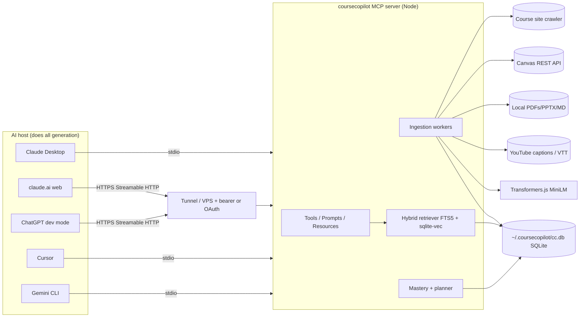

# CourseCopilot: Technical Prep Sheet (Build Spec v1)

> "NotebookLM for your actual classes, open source, inside the AI you already use."
> Repo: https://github.com/Verdent06/coursecopilot (MIT). Spec date: Oct 13, 2026. Audience: a Cursor cloud agent building it PR by PR, plus Vedant.
> Rule for this doc: anything we couldn't confirm is marked **[UNVERIFIED]**. Builders should check those items before relying on them.

---

## 0. TL;DR of decisions

| Decision | Choice |
|---|---|
| Form factor | A single **MCP server**. Your AI assistant (Claude, ChatGPT, Cursor, Gemini) does all the text generation. CourseCopilot never calls an LLM and needs **no API key**. |
| Language/SDK | **TypeScript on Node ≥ 20**, official MCP TS SDK **v2** (`@modelcontextprotocol/server`) |
| Storage | One local **SQLite** file: `better-sqlite3` + **FTS5** (keyword search) + **sqlite-vec** (vectors) |
| Embeddings | **Transformers.js** (`@huggingface/transformers`) running `Xenova/all-MiniLM-L6-v2` (384-dim, about 23 MB, downloaded once). Falls back to FTS-only if the model can't load. |
| Transports | **stdio** for local clients. **Streamable HTTP** (`coursecopilot serve`) for ChatGPT and claude.ai web. |
| Install | `npx -y coursecopilot` (one line), plus a Cursor deeplink button, a Claude Desktop `.mcpb` file, and `gemini mcp add` |
| Remote mode | Optional, self-hosted. `coursecopilot serve --http` with a bearer token, reached through a tunnel (Cloudflare Tunnel / OpenAI Secure MCP Tunnel) or a small VPS. No central hosted service in v1. |

---

## 1. Problem and target user

**Problem.** A student's course material is scattered across a professor's custom website (for example UMich EECS 376 runs its own site, not Canvas), Canvas modules, PDFs, slide decks, and lecture videos. General AI assistants don't know any of it, so their answers are generic and come without citations. NotebookLM can ground answers in your files, but you have to upload everything by hand, it lives in its own app, and it isn't open source. Students already have Claude or ChatGPT open. They want "explain the pumping lemma *the way Lecture 7 did it*, with the slide number," plus quizzes built from that material and a plan for the week before the exam.

**Primary user.** A university student (CS/STEM first) who uses Claude Desktop/claude.ai, ChatGPT, Cursor, or Gemini CLI weekly and takes 3–5 courses a term.
**Secondary user.** TAs and instructors who want to point students at a ready-made "course pack" for a public course site.

**The "damn I wish I had that" moment:** paste a course URL, then ask "what's on the midterm and where am I weak?" and get back a cited answer plus a 7-day plan.

---

## 2. v1 scope vs out of scope

**In scope (v1)**
- Add a course. Ingest from: (a) a public course website URL (crawled within limits), (b) Canvas via a personal access token, (c) local PDFs/PPTX/Markdown/TXT files and folders, (d) YouTube links (captions only).
- Hybrid search (keyword + vector) with citations to page, slide, URL anchor, or timestamp.
- Quiz support. The server hands back source chunks and a quiz scaffold, the host AI writes the questions, and the server records attempts.
- Topic extraction (heuristic) and weak-spot tracking per topic.
- Exam study plan data: topics ranked by weakness × exam weight × how close the exam is.
- MCP prompts and resources (Section 7).
- Local-first stdio server, plus an optional self-hosted HTTP mode.

**Explicitly out of scope (v1)**
- Calling any LLM API, or hosting a model.
- A multi-tenant hosted SaaS, user accounts, or Canvas OAuth developer keys. Canvas's own docs say multi-user apps must use OAuth; v1 is single-user and self-run.
- Local Whisper transcription of uploaded audio/video. It is planned for v1.1 as an opt-in extra (Section 9.5).
- Logging in to sites (Piazza, Gradescope, sites behind SSO), or scraping anything that needs auth other than the Canvas token.
- A GUI or web dashboard, mobile apps, flashcard spaced-repetition scheduling (v2), and ChatGPT Apps SDK custom UI widgets (v2).
- Writing anything back to Canvas.

---

## 3. Research summary (Oct 2026), with sources

### 3.1 MCP itself
- The current spec revision is **2026-07-28**. Streamable HTTP is now POST-only to a single endpoint. Every request must carry an `MCP-Protocol-Version` header that matches `_meta`, and sessions/GET streams were removed in this revision ([spec, Streamable HTTP](https://mcp-staging.mintlify.app/specification/2026-07-28/basic/transports/streamable-http)). *Note: that link is a staging mirror. Builders should confirm against modelcontextprotocol.io/specification/latest.* **[UNVERIFIED on the canonical site]**
- **TS SDK v2** (`@modelcontextprotocol/server`, `/client`, plus `/node`, `/express`, `/hono` adapters) is the stable line for the 2026-07-28 spec. v1 (`@modelcontextprotocol/sdk`) gets fixes for at least 6 months after 2026-07-27 ([typescript-sdk](https://github.com/modelcontextprotocol/typescript-sdk)).
- **Python SDK v2** (`pip install mcp`) supports stdio, Streamable HTTP, and SSE ([python-sdk](https://github.com/modelcontextprotocol/python-sdk)).
- OpenAI's docs still name `@modelcontextprotocol/sdk` ([OpenAI build MCP server](https://developers.openai.com/plugins/build/mcp-server)). Both work. We use v2 and test against ChatGPT early (Milestone M8), because client support for the new revision may lag **[UNVERIFIED]**. If ChatGPT or Claude reject 2026-07-28, fall back to SDK v1.x. The transport layer sits behind one adapter file so this swap stays cheap.

### 3.2 How each client installs servers today
| Client | Mechanism | Local stdio? | Source |
|---|---|---|---|
| Claude Desktop | `claude_desktop_config.json` `mcpServers`, or a `.mcpb` bundle (a zip with `manifest.json`). Install it by double-clicking, or via Settings → Extensions → Advanced → Install Extension | Yes | [Claude MCPB docs](https://claude.com/docs/connectors/building/mcpb), [Help Center](https://support.claude.com/en/articles/10949351-getting-started-with-local-mcp-servers-on-claude-desktop) |
| claude.ai web / mobile / Cowork | Custom connector: Customize → Connectors → Add → Custom → Web → paste URL. **Anthropic's cloud** connects to it, so it must be publicly reachable. Free plan allows 1 custom connector | No (remote only) | [Help Center](https://support.claude.com/en/articles/11176164-use-connectors-to-extend-claude-s-capabilities), [remote MCP](https://support.claude.com/en/articles/11175166-get-started-with-custom-connectors-using-remote-mcp) |
| ChatGPT | Developer mode → Plugins → "Add custom MCP server" → URL, or Secure MCP Tunnel. Supports SSE and streaming HTTP; auth can be OAuth or none. **Remote only.** **Pro: read/fetch tools only; full MCP (write actions) is Business/Enterprise/Edu** | No (remote, or OpenAI tunnel) | [OpenAI Help](https://help.openai.com/en/articles/12584461-developer-mode-and-mcp-apps-in-chatgpt), [custom MCP server](https://developers.openai.com/api/docs/guides/custom-mcp-server), [Secure MCP Tunnel](https://developers.openai.com/api/docs/guides/secure-mcp-tunnels.md) |
| Cursor | `~/.cursor/mcp.json` or `.cursor/mcp.json`, or deeplink `cursor://anysphere.cursor-deeplink/mcp/install?name=$NAME&config=$BASE64` | Yes | [Cursor install links](https://cursor.com/docs/mcp/install-links), [Cursor MCP help](https://cursor.com/help/customization/mcp.md) |
| Gemini CLI | `gemini mcp add [-s user] <name> <cmd> [args]` writes to `~/.gemini/settings.json`; `-t http` for URLs | Yes | [Gemini CLI MCP docs](https://geminicli.com/docs/tools/mcp-server/) |
| Gemini web app | Custom MCP support **[UNVERIFIED / not found]**. Treat as unsupported in v1 | n/a | |

Plan/eligibility caveats:
- **ChatGPT Plus/Free:** we did not confirm developer-mode access on these plans. **[UNVERIFIED]** The README must say "ChatGPT support needs a plan with developer mode. Check OpenAI's page."
- The Help Center states Pro is limited to read/fetch. We don't know exactly how ChatGPT classifies a tool as "write" **[UNVERIFIED]**. We assume it uses MCP tool annotations (`readOnlyHint`). So we mark retrieval tools `readOnlyHint: true`, and design so the core value (cited Q&A, quiz generation) works with read-only tools alone. Recording quiz results is a write tool and may be unavailable on Pro.
- Anthropic says MCPB directory submissions are deprecated; you distribute the `.mcpb` file yourself ([MCPB docs](https://claude.com/docs/connectors/building/mcpb)). Claude Desktop ships a Node runtime for Node-based MCPB extensions **[UNVERIFIED; check the MCPB manifest spec `server.type: "node"`]**, which is one more reason to choose TS.

### 3.3 npx vs uvx
Both are one line. **npx wins for us** because Cursor/Claude users most often already have Node, Cursor's own docs use `npx -y` as their example, MCPB supports Node bundles, and Transformers.js plus sqlite-vec both ship npm packages. uvx needs `uv` installed first, which is one more step for most students.

### 3.4 Local embeddings, no API key
| Option | Notes | Weight |
|---|---|---|
| **Transformers.js + all-MiniLM-L6-v2 (chosen)** | Runs ONNX in Node, 384-dim vectors ([HF model card](https://huggingface.co/Xenova/all-MiniLM-L6-v2)) | Model about 23 MB, downloaded on first use and cached ([example repo](https://github.com/vahidkowsari/pi-local-rag/blob/main/__tests__/embedding.test.ts)); onnxruntime-node native binary adds tens of MB **[UNVERIFIED exact size]** |
| fastembed (Python/Rust) | Good quality, but it's Python-first, which conflicts with the TS choice | |
| **sqlite-vec (chosen)** | SQLite extension with an npm package; loads into better-sqlite3 | Small (single native lib, about 1 MB-ish **[UNVERIFIED]**) |
| LanceDB | Strong, but a heavier native dependency, and it's overkill for under 100k chunks per user | Heavier |
| Fallback | FTS5 BM25 only, if the vec or ONNX native load fails (some ARM/Windows edge cases) | 0 |

Possible upgrade: `bge-small-en-v1.5` (also 384-dim) for better retrieval quality. It's a config switch, and the default stays MiniLM.

### 3.5 Transcription
- **YouTube captions (v1).** Fetch the existing caption track (manual first, auto-generated second) and keep the timestamps. Use an npm caption-fetcher library or `yt-dlp --write-auto-subs --skip-download` if it's installed. YouTube changes its internals often and caption scraping breaks periodically **[risk]**. Wrap it behind an interface and fall back to yt-dlp.
- **Local Whisper (v1.1, opt-in).** whisper.cpp via an npm binding, or call `whisper`/`faster-whisper` if the user has it installed. Too heavy (models are hundreds of MB, plus ffmpeg) to be a default dependency.
- **User-supplied transcripts** (`.vtt`/`.srt`, e.g. Canvas/Kaltura/Panopto exports): parse them with timestamps in v1. This is cheap and covers lecture capture systems we can't log in to.

### 3.6 Canvas API token flow
- A student creates a token at **Canvas → Account → Settings → Approved Integrations → "+ New Access Token"**, then sets `CANVAS_BASE_URL` (e.g. `https://umich.instructure.com`) and `CANVAS_TOKEN`. The API also exposes token creation via `POST /api/v1/users/:user_id/tokens` ([Canvas access tokens](https://documentation.instructure.com/doc/api/access_tokens.html)).
- **Policy caveat:** Canvas docs say asking other users to manually generate a token for your application violates the API policy, and multi-user apps MUST use OAuth ([Canvas OAuth2](https://documentation.instructure.com/doc/api/file.oauth.html)). Our framing: CourseCopilot is software *you* run locally with *your own* token, not a service that collects tokens. We never accept Canvas tokens in hosted mode run by someone else. Some schools disable student tokens **[risk]**. Expect that and fall back to manual file export.
- Endpoints to use: `GET /api/v1/courses?enrollment_state=active`, `/courses/:id/modules?include[]=items`, `/courses/:id/pages`, `/pages/:url`, `/courses/:id/files` (may be 403 for students; if so, get files via module items), `/courses/:id/assignments`, `/courses/:id/front_page`, `/courses/:id/assignment_groups` (for exam weights). Follow `Link: rel="next"` for pagination and respect `X-Rate-Limit-Remaining`.

### 3.7 Crawling course sites
- Honor `robots.txt` (use the `robots-parser` npm package) with UA `CourseCopilot/<ver> (+repo URL)`.
- Same-origin and path-prefix scope by default (e.g. everything under `https://eecs376.org/`). Max depth 3, max 300 pages, concurrency 2, and at least 500 ms between requests per host.
- Follow linked PDFs/PPTX even if they're one hop off-origin (e.g. Google Drive direct links, a GitHub raw link), but don't crawl further from them.
- Skip `mailto:`, calendars, `.zip`, video files, and anything that looks like a login page (has a password input, or redirects to an SSO host). Report those as "skipped: requires login."
- JS-rendered sites: v1 uses static HTML only. If a page yields under 200 chars of text, flag it "may need JS rendering." Optional Playwright support is planned for v1.1.
- Content-hash every fetched document (sha256) so re-syncs are incremental. Use ETag/Last-Modified when available.

### 3.8 Competitors and the real gap
- **NotebookLM (Google):** grounded Q&A, audio overviews, quizzes/flashcards. But it's a closed separate app with manual upload, no Canvas/course-site sync, and no cross-session weakness model inside your own assistant. *Its current feature list wasn't re-verified this session* **[UNVERIFIED details]**.
- **Canvas MCP servers on GitHub:** e.g. [xmike04/canvas-student-mcp](https://github.com/xmike04/canvas-student-mcp) (read-only, extracts docs, exports a course to Markdown, quiz-style prompts), [vishalsachdev/canvas-mcp](https://github.com/vishalsachdev/canvas-mcp), [Indigo-10/mcp-canvas-lms](https://github.com/Indigo-10/mcp-canvas-lms), [bruchris/canvas-lms-mcp](https://github.com/bruchris/canvas-lms-mcp/), and [a Glama-listed one that pushes to NotebookLM via Playwright](https://glama.ai/mcp/servers/Shigakuresama/canvas-mcp-developer). These are mostly **Canvas API wrappers**: assignments, grades, files.
- **Canvas-integrated AI tools** (school-licensed tutors, Khanmigo-style products) are vendor- or school-gated **[not researched in depth]**.
- **The gap CourseCopilot fills:** (1) **non-Canvas sources** like custom course sites, YouTube lectures, and PDFs, unified per course; (2) **real retrieval with precise citations** (page/slide/timestamp), not raw file dumps; (3) **persistent learning state** (quiz attempts → topic mastery → exam plan) carried across chats and across assistants; (4) one-line install, local-first, no API key.

---

## 4. Recommended stack (and why)

**Pick: TypeScript / Node 20+.**
- npx is the lowest-friction install for our audience, and Claude Desktop MCPB supports Node.
- The first-party TS SDK v2 tracks the newest spec.
- Transformers.js plus sqlite-vec give us local embeddings with no Python.
- One language for CLI, server, and tests.

**Tradeoffs we accept:**
- Native modules (`better-sqlite3`, `sqlite-vec`, `onnxruntime-node`) can fail on unusual platforms. Mitigation: prebuilt binaries, a CI matrix, and graceful degradation to FTS-only.
- Python has better PDF/ASR libraries. Mitigation: `unpdf`/`pdfjs-dist` is good enough for text PDFs, and ASR is deferred.

**Libraries (pin major versions; verify current versions when starting M0):**
- MCP: `@modelcontextprotocol/server`, `@modelcontextprotocol/node` (HTTP), `zod` (schemas)
- Storage: `better-sqlite3`, `sqlite-vec`
- Embeddings: `@huggingface/transformers`
- PDF: `unpdf` (pdf.js-based; gives per-page text)
- PPTX: `jszip` + `fast-xml-parser` (read `ppt/slides/slideN.xml` and the notes slides)
- DOCX (nice to have): `mammoth`
- HTML: `undici` fetch, `cheerio`, `@mozilla/readability` + `linkedom`, then `turndown` to Markdown
- Crawl: `robots-parser`, `p-limit`
- Captions: a YouTube transcript library, with `yt-dlp` as an optional fallback; `@plussub/srt-vtt-parser` or a hand-written VTT parser
- CLI: `commander`
- Test: `vitest`, `@modelcontextprotocol/client` (for end-to-end), `msw` or a local static server for fixtures
- Lint/format: `biome` (one tool)

---

## 5. Architecture



**Key flows**
1. *Add source:* `add_source` → enqueue job → fetch → extract into segments with locators → chunk → embed → write to DB → job status `done`. Ingestion runs in-process on an async queue. Long jobs return a `job_id` right away so tool calls never block for minutes (clients time out). `get_ingest_status` polls the job.
2. *Ask:* the host calls `search_course` → gets the top-k chunks with citation objects → the host writes the answer and quotes the citations.
3. *Quiz:* `generate_quiz_context` returns chunks grouped by topic plus question-writing instructions → the host writes questions and grades the user's answers → `record_quiz_attempt` stores the results → mastery updates.
4. *Plan:* `get_study_plan` returns topics ranked with recommended sessions → the host formats the plan.

**Design principle: the host AI does generation.** The server only fetches, parses, indexes, retrieves, stores, and scores. No LLM SDKs appear in dependencies, and CI enforces this (a lint rule fails on `openai`, `@anthropic-ai/sdk`, `@google/genai`). Where we need "intelligence" (topic labels, quiz questions, grading), we return structured context plus instructions, and the host writes back structured results through a tool (e.g. `set_topics`, `record_quiz_attempt`).

---

## 6. Data model (SQLite, `~/.coursecopilot/cc.db`, override with `COURSECOPILOT_HOME`)

```sql
CREATE TABLE courses(
  id TEXT PRIMARY KEY,            -- slug, e.g. "eecs376-f26"
  title TEXT NOT NULL,
  term TEXT,                      -- "F26"
  exam_dates_json TEXT DEFAULT '[]', -- [{"name":"Midterm","date":"2026-10-28","topics":["..."],"weight":0.25}]
  created_at TEXT, updated_at TEXT
);

CREATE TABLE sources(
  id TEXT PRIMARY KEY,            -- ulid
  course_id TEXT REFERENCES courses(id) ON DELETE CASCADE,
  kind TEXT CHECK(kind IN ('website','canvas','file','folder','youtube','transcript')),
  uri TEXT NOT NULL,              -- URL, canvas://course/123, file:///abs/path
  title TEXT,
  config_json TEXT,               -- crawl limits, canvas course id, etc. NEVER the token
  status TEXT CHECK(status IN ('queued','running','done','error','partial')),
  error TEXT,
  last_synced_at TEXT
);

CREATE TABLE documents(           -- one fetched unit: a page, a PDF, a deck, a video
  id TEXT PRIMARY KEY,
  source_id TEXT REFERENCES sources(id) ON DELETE CASCADE,
  course_id TEXT,
  url TEXT,                       -- canonical URL or file path
  title TEXT,
  mime TEXT,
  content_hash TEXT,              -- sha256 of raw bytes, for incremental sync
  fetched_at TEXT,
  meta_json TEXT                  -- {lecture_no, published_at, duration_s, page_count}
);

CREATE TABLE chunks(
  id INTEGER PRIMARY KEY,         -- rowid shared with vec + fts
  document_id TEXT REFERENCES documents(id) ON DELETE CASCADE,
  course_id TEXT,
  ord INTEGER,                    -- order within document
  text TEXT NOT NULL,
  locator_json TEXT NOT NULL,     -- see Citation format §10
  heading_path TEXT,              -- "Lecture 7 > Pumping Lemma > Proof"
  token_count INTEGER
);
CREATE VIRTUAL TABLE chunks_fts USING fts5(text, heading_path, content='chunks', content_rowid='id');
CREATE VIRTUAL TABLE chunks_vec USING vec0(embedding float[384]);

CREATE TABLE topics(
  id TEXT PRIMARY KEY,
  course_id TEXT,
  name TEXT,                      -- "Pumping lemma"
  origin TEXT CHECK(origin IN ('heuristic','host','user')),
  UNIQUE(course_id, name)
);
CREATE TABLE chunk_topics(chunk_id INTEGER, topic_id TEXT, weight REAL, PRIMARY KEY(chunk_id, topic_id));

CREATE TABLE quiz_attempts(
  id TEXT PRIMARY KEY,
  course_id TEXT,
  created_at TEXT,
  mode TEXT                       -- 'quiz','exam_sim','quick_check'
);
CREATE TABLE quiz_items(
  id TEXT PRIMARY KEY,
  attempt_id TEXT REFERENCES quiz_attempts(id) ON DELETE CASCADE,
  topic_id TEXT,
  question TEXT,
  user_answer TEXT,
  correct INTEGER CHECK(correct IN (0,1)),
  partial_credit REAL,            -- 0..1, host-graded
  difficulty INTEGER CHECK(difficulty BETWEEN 1 AND 3),
  confidence INTEGER,             -- optional self-report 1..3
  cited_chunk_ids TEXT            -- json array
);

CREATE TABLE topic_mastery(
  course_id TEXT, topic_id TEXT,
  alpha REAL DEFAULT 1, beta REAL DEFAULT 1,  -- Beta posterior
  last_seen_at TEXT, n_attempts INTEGER DEFAULT 0,
  PRIMARY KEY(course_id, topic_id)
);

CREATE TABLE jobs(id TEXT PRIMARY KEY, source_id TEXT, state TEXT, progress REAL, message TEXT, started_at TEXT, finished_at TEXT);
CREATE TABLE schema_version(v INTEGER);
```

Secrets: the Canvas token comes from env `CANVAS_TOKEN`, or the OS keychain via `keytar` **[optional; keytar is archived (UNVERIFIED), so prefer env plus a 0600 file `~/.coursecopilot/secrets.json`]**. It is never stored in the DB or returned by any tool.

---

## 7. MCP surface

### 7.1 Conventions
- Every tool has a zod input schema, returns `structuredContent` (JSON) **and** a short text rendering for hosts that ignore structured output, and sets annotations: `readOnlyHint` (true for retrieval), `destructiveHint` (true for remove), `openWorldHint` (true for tools that fetch the web).
- Errors use `isError: true` with an actionable message, e.g. "Canvas returned 401. Your token may be expired. Create a new one at Account → Settings → Approved Integrations."
- `course_id` is optional on retrieval tools when there's only one course. Otherwise the error lists the valid ids.
- ChatGPT compatibility: also expose **`search`** and **`fetch`** tools with the shapes OpenAI documents for read-only/deep-research use **[UNVERIFIED exact required schema; check the current OpenAI MCP docs in M8]**. They're thin aliases over `search_course` and `get_chunk`.

### 7.2 Tools

| # | Name | RO? | Input | Output |
|---|---|---|---|---|
| 1 | `add_course` | no | `{title, term?, course_id?}` | `{course_id}` |
| 2 | `list_courses` | yes | `{}` | `[{course_id,title,term,source_count,chunk_count,exams}]` |
| 3 | `add_source` | no (openWorld) | `{course_id, kind:'website'\|'canvas'\|'file'\|'folder'\|'youtube'\|'transcript', uri, options?:{max_depth?,max_pages?,include_prefix?,canvas_course_id?,lecture_no?}}` | `{source_id, job_id, status:'queued'}` |
| 4 | `get_ingest_status` | yes | `{job_id? , course_id?}` | `[{job_id,source_id,state,progress,message,docs,chunks,skipped:[{url,reason}]}]` |
| 5 | `list_sources` | yes | `{course_id}` | `[{source_id,kind,uri,status,last_synced_at,doc_count}]` |
| 6 | `sync_course` | no | `{course_id, source_id?}` | `{job_ids}` (incremental re-fetch) |
| 7 | `remove_source` | destructive | `{source_id}` | `{removed_chunks}` |
| 8 | `canvas_list_courses` | yes (openWorld) | `{}` | `[{canvas_course_id,name,term}]`, using the env token |
| 9 | `search_course` | yes | `{query, course_id?, k?=8 (max 20), source_kinds?, topic?}` | `{results:[{chunk_id,text,score,citation}]}` |
| 10 | `get_chunk` | yes | `{chunk_id, context?=1}` | `{chunk, neighbors:[...], citation}` |
| 11 | `get_course_outline` | yes | `{course_id}` | `{documents grouped by source, lectures in order, topics}` |
| 12 | `set_topics` | no | `{course_id, topics:[{name, chunk_ids?:[], keywords?:[]}]}` | `{topic_ids}`; lets the host label topics |
| 13 | `generate_quiz_context` | yes | `{course_id, topics?:[], n?=5, difficulty?:1-3, focus?:'weak'\|'all'\|'exam', exam_name?}` | `{items:[{topic, chunks:[{chunk_id,text,citation}]}], instructions}` |
| 14 | `record_quiz_attempt` | no | `{course_id, mode?, items:[{topic, question, user_answer, correct, partial_credit?, difficulty?, confidence?, cited_chunk_ids?}]}` | `{attempt_id, mastery_delta:[{topic, before, after}]}` |
| 15 | `get_weak_spots` | yes | `{course_id, limit?=5}` | `[{topic, mastery, uncertainty, n_attempts, last_seen_days, suggested_chunks:[citation]}]` |
| 16 | `set_exam` | no | `{course_id, name, date, topics?:[], weight?}` | `{exams}` |
| 17 | `get_study_plan` | yes | `{course_id, exam_name?, days?, minutes_per_day?=60}` | `{days:[{date, sessions:[{topic, activity:'review'\|'quiz'\|'practice', minutes, chunks:[citation]}]}], rationale}` |
| 18 | `search` / `fetch` | yes | ChatGPT-compatible aliases | see 7.1 |

`instructions` returned by `generate_quiz_context` (fixed text, versioned):
> "Write N questions using ONLY the provided chunks. Each question must cite its chunk_id(s). Mix multiple-choice and short-answer. Ask one at a time; after the user answers, grade it, show the citation, and when the quiz ends call record_quiz_attempt with all items."

### 7.3 Example calls
```json
// add a public course site
{"name":"add_source","arguments":{"course_id":"eecs376-f26","kind":"website","uri":"https://eecs376.org/","options":{"max_depth":3,"max_pages":300}}}
// → {"source_id":"01J...","job_id":"job_01J...","status":"queued"}

{"name":"search_course","arguments":{"course_id":"eecs376-f26","query":"pumping lemma proof that a^n b^n is not regular","k":5}}
// → {"results":[{"chunk_id":4812,"score":0.83,"text":"...","citation":{"label":"[Lecture 7 slides, slide 14]","url":"https://eecs376.org/lec07.pdf#page=14","kind":"pdf","page":14}}]}

{"name":"record_quiz_attempt","arguments":{"course_id":"eecs376-f26","items":[{"topic":"Pumping lemma","question":"...","user_answer":"...","correct":false,"partial_credit":0.5,"difficulty":2,"cited_chunk_ids":[4812]}]}}
// → {"attempt_id":"qa_...","mastery_delta":[{"topic":"Pumping lemma","before":0.50,"after":0.46}]}
```

### 7.4 Prompts (user-invokable templates; e.g. slash commands in Claude/Cursor)
- `study_session(course_id, minutes=30)`: check weak spots, then a quick quiz, then record it.
- `explain_with_sources(course_id, question)`: answer only from search results, cite every claim, and say "not in course materials" if retrieval comes back empty.
- `exam_prep(course_id, exam_name)`: run get_study_plan and turn it into a checklist.
- `quiz_me(course_id, topic?, n=5)`.
- `add_my_course(url)`: guided setup that asks for the course name and exam dates.

### 7.5 Resources
- `coursecopilot://courses` (list)
- `coursecopilot://course/{id}/outline`
- `coursecopilot://course/{id}/mastery`
- `coursecopilot://document/{id}` (full extracted Markdown, for hosts that support attaching resources)

---

## 8. Chunking and retrieval
- Segment by structure first (PDF page, slide, HTML heading section, caption window), then split to **about 350 tokens with 50 overlap** (approximate tokens by words × 1.3). Never cross a page or slide boundary, so each chunk keeps one locator. For captions: about 60 s windows, merged until about 350 tokens, keeping `start_s`/`end_s`.
- Hybrid score: run BM25 (FTS5) top 30 and vector top 30, then merge with **Reciprocal Rank Fusion** (k=60). Boost +10% if the topic filter matches. Dedupe adjacent chunks from the same document.
- Embedding batches of 32. Run them in a worker thread so the MCP stdio loop stays responsive.
- If the ONNX model is unavailable, return FTS results and add `"degraded":"keyword_only"`.

---

## 9. Ingestion pipelines (per source type) and edge cases

### 9.1 Website
Fetch the seed → check robots.txt → BFS within scope (depth, page cap, prefix) → for each HTML page, Readability extract → Markdown → split by h1–h3 → locator `{url, anchor: nearest id/heading slug}`. Enqueue linked PDF/PPTX/DOCX files as documents of the same source.
Edge cases:
- Duplicate URLs (`?utm`, trailing slash, `#frag`): canonicalize.
- Non-HTML content types: route by MIME, not by extension.
- Huge PDFs (>50 MB): skip and report.
- Redirects to SSO: mark "login required."
- Rate limit or 429: back off exponentially, at most 3 retries.
- Calendar/schedule tables: keep them as Markdown tables, because they're how we auto-detect exam dates. Regex for "Midterm|Exam|Final" near dates, and *suggest* `set_exam` to the host. Never set it automatically.
- Encoding: let undici decode with the charset; replace bad bytes.

### 9.2 Canvas
Validate the token (`GET /api/v1/users/self`). List active courses. For the chosen course, ingest the front page, pages, modules → items (Page, File, ExternalUrl, Assignment description). For File items, download through the file `url` (follow redirects; links are short-lived) and send them to the file pipeline. Locator `{url: html_url, canvas: {course_id, item_type, item_id}, page?}`.
Edge cases:
- 401 (expired token)
- 403 on `/files` (students): use module items
- Locked modules: skip, with reason
- External tools/LTI (Panopto/Kaltura): not fetchable; report "export transcript as VTT and add it as a transcript source"
- Pagination
- Throttling (`X-Rate-Limit-Remaining` < 50 → slow down)
- Media comments: skip

### 9.3 Files (PDF / PPTX / DOCX / MD / TXT / folder)
- PDF: per-page text via unpdf; locator `{path|url, page}`. Scanned PDFs (under 20 chars/page on most pages): mark `needs_ocr`; OCR is out of scope for v1.
- PPTX: slide text plus speaker notes; locator `{slide, title}`.
- Folders: recurse, ignore dotfiles, and cap at 2,000 files.
- Watch mode: none in v1; use `sync_course`.
- Paths must be absolute. In remote mode, local file paths are disabled unless `--allow-path` is set, so a remote caller can't read arbitrary disk.

### 9.4 YouTube
Parse the video id (watch, youtu.be, shorts, embed, playlist → expand up to 50 videos). Fetch the caption track (en manual > en auto > any language, recording `lang`). Locator `{url, video_id, start_s, end_s}` → citation link `https://youtu.be/<id>?t=<start_s>`. Get the title via oEmbed (`https://www.youtube.com/oembed?url=...`).
Edge cases: no captions (report it and suggest the v1.1 Whisper path), age-restricted/private videos, captions-library breakage (try yt-dlp if on PATH).

### 9.5 Transcripts (VTT/SRT) and future audio
Parse cues → windows as in 9.4. Locator `{path|url, start_s}`. v1.1: `kind:'audio'` with an optional whisper.cpp model download (`--with-whisper`), opt-in only.

### 9.6 Topic extraction (heuristic, no LLM)
Candidate topics = PDF/slide titles + HTML h2/h3 + lecture names from the schedule. Normalize, dedupe by embedding similarity (>0.85 cosine). Assign chunks to topics by heading_path match, else nearest topic centroid (cosine > 0.4). The host can override with `set_topics`; `get_course_outline` returns the topics so the host can propose better ones.

---

## 10. Citation format
Every result carries:
```json
{"label":"[EECS 376 · Lecture 7 slides · slide 14]",
 "kind":"pdf|pptx|web|canvas|youtube|transcript|file",
 "url":"https://.../lec07.pdf#page=14",
 "title":"Lecture 7: Nonregular languages",
 "page":14, "slide":null, "anchor":null, "start_s":null, "end_s":null,
 "source_id":"...", "document_id":"...", "chunk_id":4812}
```
Label rules:
- PDF → `p. N` and `url#page=N`
- PPTX → `slide N` (file URL; there's no deep link)
- Web → section heading and `url#anchor`
- YouTube → `mm:ss` and `?t=Ns`
- Local file → `file:///...` path

The `explain_with_sources` prompt and the tool descriptions tell the host to render citations as Markdown links with the label text.

---

## 11. Weak-spot algorithm
- Each (course, topic) has a Beta(α, β) prior of (1, 1).
- On each quiz item: score s = partial_credit if given, else correct ∈ {0,1}. Weight w = {1:0.7, 2:1.0, 3:1.3}[difficulty]. If confidence was high and the answer wrong, multiply w by 1.2 (overconfidence is a stronger signal). Update α += w·s, β += w·(1−s).
- **Forgetting:** before reading mastery, decay toward the prior. With d = days since last_seen and half-life H = 10 days: α' = 1 + (α−1)·2^(−d/H), and likewise for β.
- mastery = α/(α+β). uncertainty = Beta variance.
- **Weakness score** = (1 − mastery) + 0.5·√variance + 0.2·[never attempted] , × exam_weight(topic) if an upcoming exam lists that topic (default 1.0; 1.5 if listed).
- `get_weak_spots` returns the top N by weakness score, with 2 suggested chunks per topic (the highest-ranked chunks for that topic).
- **Study plan:** let D = days until the exam (default 7 if none). Allocate minutes_per_day × D across topics in proportion to weakness score (minimum 15 minutes per topic chosen). Order: weakest first. Each topic gets review → quiz, with a spaced repeat on day ⌈D/2⌉ and day D−1, and the final day is a mixed exam_sim. The plan is deterministic, so it's testable.
- All constants live in `config.ts` and are documented as tunable. They are not research-validated **[heuristic]**.

---

## 12. Install and distribution (per client)

Published package: **npm `coursecopilot`** (check the name is free in M0; fallback `@verdent06/coursecopilot` **[UNVERIFIED availability]**). Binary `coursecopilot`; with no args it runs the stdio server.

**Claude Desktop (JSON)** — macOS `~/Library/Application Support/Claude/claude_desktop_config.json`, Windows `%APPDATA%\Claude\claude_desktop_config.json`:
```json
{
  "mcpServers": {
    "coursecopilot": {
      "command": "npx",
      "args": ["-y", "coursecopilot@latest"],
      "env": { "CANVAS_BASE_URL": "https://umich.instructure.com", "CANVAS_TOKEN": "optional" }
    }
  }
}
```
**Claude Desktop (.mcpb):** attach `coursecopilot.mcpb` to each GitHub Release, built with `npx @anthropic-ai/mcpb pack` **[verify CLI package name]**. The manifest declares `user_config` for the Canvas URL and a sensitive token field, so the user never edits JSON. Install by double-clicking.

**Cursor:** a README button linking `cursor://anysphere.cursor-deeplink/mcp/install?name=coursecopilot&config=<base64 of {"command":"npx","args":["-y","coursecopilot@latest"]}>`. A script `scripts/make-cursor-link.ts` generates it, and CI checks the link decodes correctly. Manual alternative: the same JSON under `mcpServers` in `~/.cursor/mcp.json`.

**Claude Code (bonus):** `claude mcp add coursecopilot -- npx -y coursecopilot@latest`

**Gemini CLI:** `gemini mcp add -s user coursecopilot npx -y coursecopilot@latest`

**claude.ai web / ChatGPT:** need remote mode (Section 13). claude.ai: Customize → Connectors → Add → Custom → Web → `https://<your-host>/mcp`. ChatGPT: enable developer mode → Plugins → + → Add custom MCP server → URL (or Tunnel) → auth.

**Model download UX:** the first `add_source` triggers the ~23 MB model fetch. `coursecopilot doctor` pre-downloads it and checks native modules, and `get_ingest_status` shows "downloading embedding model."

---

## 13. Hosted / remote mode plan
- `coursecopilot serve --http --port 8787 --token <random>` serves Streamable HTTP at `/mcp` on the same DB. It binds to 127.0.0.1 by default and validates the Host header (SDK adapters provide this).
- **Auth:** v1 uses a static bearer token. claude.ai custom connectors and ChatGPT both have an OAuth path and a "no auth" path; whether either lets you paste a static bearer header is **[UNVERIFIED]**. Default: v1 supports (a) the bearer header for Cursor/Gemini/Claude Code remote, and (b) a **secret URL path** (`/mcp/<128-bit token>`) for claude.ai/ChatGPT "no auth" mode. That's documented as weaker security. **v1.1:** a minimal OAuth 2.1 authorization server for a single user (built-in password page), following the MCP auth spec.
- **Reachability options, in recommended order:**
  1. **Cloudflare Tunnel** (`cloudflared tunnel --url http://localhost:8787`). Free, laptop-hosted, only works while the laptop is on.
  2. **OpenAI Secure MCP Tunnel**, ChatGPT only (needs Platform org tunnel permissions; [docs](https://developers.openai.com/api/docs/guides/secure-mcp-tunnels.md)).
  3. **Fly.io/Railway with a Dockerfile** and a persistent volume for the DB. Docs give one-command deploys.
- **Is remote required?** Yes for ChatGPT (remote or OpenAI tunnel only) and claude.ai web/mobile (Anthropic's cloud connects, so the server must be publicly reachable). No for Claude Desktop JSON/MCPB, Cursor, Gemini CLI, or Claude Code.
- **No central public instance in v1.** Running one would mean storing other students' Canvas tokens (which conflicts with Canvas API policy) and copyrighted course material. Revisit with Canvas OAuth in v2.
- In remote mode, the `file`/`folder` source kinds are disabled unless explicitly allowed, and website crawling refuses private IP ranges (SSRF guard).

---

## 14. Privacy and local-first
- All data lives in `~/.coursecopilot/`. No telemetry. Nothing leaves the machine except fetches to the sources the user added, plus the one-time Hugging Face model download (documented; override with `COURSECOPILOT_MODEL_PATH` for offline use).
- What *does* leave: retrieved chunks are sent to whichever AI host the user chose, under that host's privacy policy. The README states this plainly.
- Copyright: we index materials for the user's own study and never redistribute. Example course packs in the repo use only openly licensed material.
- `coursecopilot export --course X` writes JSON, and `coursecopilot wipe` deletes data.
- Tokens are never logged, and logs redact `Authorization` headers.

---

## 15. Repo layout
```
coursecopilot/
  package.json  tsconfig.json  biome.json  vitest.config.ts  Dockerfile  LICENSE  README.md
  manifest.json                  # MCPB manifest
  src/
    cli.ts                       # commander: (default)=stdio, serve, doctor, export, wipe, ingest
    server/
      index.ts                   # builds McpServer, registers tools/prompts/resources
      transport-stdio.ts
      transport-http.ts          # auth, host validation, secret path
      tools/ (one file per tool) prompts/ resources/
    db/ schema.sql  migrate.ts  repo.ts
    ingest/
      queue.ts  chunker.ts  embed.ts (worker)  topics.ts
      sources/ website.ts canvas.ts file.ts pdf.ts pptx.ts docx.ts youtube.ts vtt.ts
      crawl/ robots.ts scope.ts fetch.ts
    retrieve/ hybrid.ts  citation.ts
    learn/ mastery.ts  planner.ts  config.ts
    util/ log.ts  ids.ts  ssrf.ts  secrets.ts
  test/
    unit/  integration/  e2e/
    fixtures/ site/ (static mini course site)  sample.pdf  sample.pptx  sample.vtt  canvas-mock/
  scripts/ make-cursor-link.ts  pack-mcpb.ts  demo-seed.ts
  docs/ install.md  remote.md  canvas.md  architecture.md  privacy.md
  .github/workflows/ ci.yml  release.yml
```

---

## 16. Testing and verification plan

**Unit:** chunker boundaries, locator → citation labels, RRF merge, mastery update/decay math (with golden numbers), planner determinism, robots/scope rules, SSRF guard, VTT parser, URL canonicalization.

**Integration (offline, in CI):**
- A local static server serves `test/fixtures/site` (5 HTML pages + 1 PDF + 1 PPTX + a robots.txt disallowing `/private/`). The crawl must ingest exactly the expected docs and skip `/private/`.
- An MSW Canvas mock covering pagination, a 403 on /files, and a locked module.
- A YouTube adapter with recorded fixtures (no network).
- Embeddings: CI caches the model. A separate test uses a stub embedder so unit tests never need the network.

**E2E (MCP protocol):** use `@modelcontextprotocol/client` to spawn `node dist/cli.js` over stdio, and separately connect to `serve --http`. Script: `add_course` → `add_source(fixture site)` → poll status → `search_course("pumping lemma")` asserts the top result cites `lec07.pdf` page 14 → `generate_quiz_context` → `record_quiz_attempt` (2 wrong on topic A) → `get_weak_spots` shows A first → `set_exam` → `get_study_plan` gives A the most minutes. The same script also runs with MCP Inspector for manual checks.

**Real-world demo course (manual and nightly, allowed to fail without blocking):**
- **MIT OCW 6.045J/18.400J "Automata, Computability, and Complexity"** (CC BY-NC-SA, public PDFs) **[verify the course URL and that lecture PDFs are still linked]**
- Plus a public YouTube lecture playlist with captions (e.g. an MIT OCW playlist) **[pick in M9]**
- EECS 376's public site as Vedant's personal demo **[check robots.txt and whether materials are public; don't commit its content]**

Acceptance criteria:
- At least 90% of fetchable PDFs are indexed.
- 5 hand-written questions each have the correct source in the top 5 results.
- Re-sync with no changes does 0 re-embeds.

**Client smoke checklist** (manual, with screenshots in the PR): Claude Desktop (JSON + MCPB), Cursor deeplink, Gemini CLI, claude.ai via cloudflared, ChatGPT dev mode via cloudflared. Record which tools ChatGPT allows on the tester's plan.

**Performance targets:** a 300-page site plus 30 PDFs ingests in under 10 minutes on an M1 / 4-core laptop **[target, not measured]**; `search_course` p95 under 300 ms at 50k chunks.

---

## 17. CI
- `ci.yml` on PRs: matrix {ubuntu, macos, windows} × Node {20, 22}. Runs `npm ci`, `biome check`, `tsc --noEmit`, `vitest run` (unit + integration + e2e stdio/http), a check that there are no LLM SDKs in dependencies, and a Cursor-link decode test. Caches the HF model directory.
- `release.yml` on tag `v*`: build, `npm publish --provenance`, `mcpb pack` → attach to the GitHub Release, build and push a Docker image to GHCR.
- Nightly: the real demo-course ingest (continue-on-error), plus a YouTube caption canary.

---

## 18. README outline
1. One-line pitch plus a 30 s GIF.
2. "Install in 10 seconds": buttons/snippets per client (Cursor button, Claude Desktop .mcpb, JSON, Gemini, Claude Code).
3. "Try it": paste prompts such as "Add the course at https://… and call it 'Automata'" and "Quiz me on my weakest topic."
4. Sources supported (with limits) and how to get a Canvas token.
5. Using it in ChatGPT and claude.ai (remote mode, tunnels, plan caveats).
6. How it works (diagram) and why no API key.
7. Privacy.
8. Tools reference (auto-generated from schemas by `scripts/gen-tools-doc.ts`).
9. FAQ / troubleshooting (`coursecopilot doctor`).
10. Contributing, roadmap, license.

---

## 19. Demo video script for X (about 45 s)
| t | Screen | Voice/caption |
|---|---|---|
| 0–4s | Claude Desktop, empty chat | "Your AI doesn't know your classes. Let's fix that in 10 seconds." |
| 4–10s | Click the Cursor/Claude install, paste: "Add my course https://…automata… and the lecture playlist" | "Paste a course website. Any site, not just Canvas." |
| 10–16s | Ingest status: 42 PDFs, 18 videos, done | "It crawls slides, PDFs, and lecture captions locally. No API key." |
| 16–26s | "Explain the pumping lemma like lecture 7 did." The answer shows clickable [Lec 7 · slide 14] and [Video · 23:41] | "Every answer cites the exact slide or timestamp." |
| 26–36s | "Quiz me." 3 questions, one wrong, then "Weak spot: pumping lemma" | "It quizzes you from your own course and remembers what you miss." |
| 36–43s | "Midterm is Oct 28. Plan my week." A 7-day plan appears | "Then builds your exam plan." |
| 43–48s | Split screen: same thing in ChatGPT and Cursor; repo URL and star | "Open source. Works in Claude, ChatGPT, Cursor, and Gemini. github.com/Verdent06/coursecopilot" |

---

## 20. Risks and open questions (with chosen defaults)
| Risk / question | Default |
|---|---|
| **ChatGPT access is gated** (dev mode plans; Pro = read/fetch only per the OpenAI Help Center) and needs a public URL | Core Q&A and quiz-generation tools are read-only. Document that quiz *recording* may need Claude/Cursor, or a Business plan. Test in M8. Keep the `search`/`fetch` aliases. |
| Spec 2026-07-28 / SDK v2 adoption by clients may lag | Keep the transport behind an adapter; fall back to SDK v1.x if a smoke test fails. |
| Canvas: students' token generation may be disabled by the school; the API policy forbids collecting tokens | Local self-use only, never hosted for others; fallback is manual file export. v2: OAuth developer key via the school. |
| YouTube caption scraping breaks | Adapter + yt-dlp fallback + nightly canary + VTT import. |
| Native module install failures (Windows/ARM) | Prebuilt binaries, `doctor`, FTS-only degradation, Docker image. |
| Copyright / ToS of crawling course sites | robots.txt, rate limits, personal use only, no redistribution, demo uses OCW. |
| JS-only course sites | Detect and warn; optional Playwright in v1.1. |
| Large ingest blocking tool calls / timeouts | Async jobs + status polling. |
| Remote auth for claude.ai/ChatGPT without OAuth | v1 secret-path URL (documented as weaker); v1.1 single-user OAuth. |
| npm name `coursecopilot` taken | Fall back to the scoped name. |
| Topic quality from heuristics | Host can override via `set_topics`; prompt `add_my_course` asks the host to propose topics. |
| Gemini web app MCP support | Treat as unsupported; Gemini CLI only. |

---

## 21. Milestones (sequenced, PR-sized, each independently testable)

| # | PR | Contents | Done when |
|---|---|---|---|
| M0 | Scaffold | TS project, biome, vitest, CI matrix, `cli.ts` stdio server with a `ping`/`list_courses` stub, npm name check | CI green; MCP Inspector lists tools |
| M1 | DB + courses | schema, migrations, `add_course`/`list_courses`/`set_exam`, resources `courses` | unit tests + e2e stdio test |
| M2 | Files pipeline | chunker, PDF/PPTX/MD/TXT/folder, job queue, `add_source(file)`, `get_ingest_status`, `list_sources`, `remove_source` | fixtures ingest with correct locators |
| M3 | Search | FTS5 + transformers.js worker + sqlite-vec + RRF, `search_course`, `get_chunk`, citation builder, keyword-only fallback | golden retrieval test (lec07 p14 top-1) |
| M4 | Website crawler | robots, scope, limits, Readability, linked files, SSRF guard, incremental hash, `sync_course` | fixture-site test incl. robots disallow and re-sync = 0 re-embeds |
| M5 | Canvas | token validate, `canvas_list_courses`, modules/pages/files, pagination, throttling | MSW mock suite |
| M6 | YouTube + VTT | id parsing, captions adapter, yt-dlp fallback, timestamp citations | recorded fixtures |
| M7 | Learning layer | topics heuristic, `set_topics`, `generate_quiz_context`, `record_quiz_attempt`, mastery, `get_weak_spots`, `get_study_plan`, prompts, mastery/outline resources | math golden tests + full e2e scenario (§16) |
| M8 | Remote mode | `serve --http`, bearer + secret path, host validation, Dockerfile, `search`/`fetch` aliases, remote docs | e2e over HTTP; manual claude.ai + ChatGPT smoke via cloudflared with screenshots |
| M9 | Distribution | npm publish workflow, MCPB manifest + pack, Cursor link generator, `doctor`, README, tools doc gen, OCW demo seed script | fresh-machine install in each client works; release v0.1.0 |
| M10 | Polish + demo | perf pass, error messages, demo recording assets, nightly real-course job | demo script reproducible from `scripts/demo-seed.ts` |

Parallelizable after M3: M4, M5, M6 (separate source adapters). M7 depends on M3. M8 depends on M7 for full value but can start after M3.

**Instructions to the builder agent:** one milestone per PR (except the M0+M1 bootstrap, which shipped together). Don't add LLM SDK dependencies. Keep every tool's schema in its own file with a doc comment (that's what generates the README). Mark any behavior you couldn't verify against live clients in the PR description.

---

## 22. Spec amendments (M0 / M1)

Chosen while implementing the scaffold. Later milestones should treat these as part of the spec.

1. **npm name.** `coursecopilot` is unpublished on the npm registry (GET returned 404 as of 2026-10-13). Keep the unscoped name.
2. **FTS5 external-content triggers.** `chunks_fts` uses `content='chunks'`. SQLite does not copy rows into that FTS table automatically, so `schema.sql` includes `AFTER INSERT/DELETE/UPDATE` triggers on `chunks`.
3. **`IF NOT EXISTS`.** DDL uses `IF NOT EXISTS` so `migrate()` is idempotent. `schema_version` is seeded with `v = 1`.
4. **sqlite-vec is optional at runtime.** `chunks_vec` is created only if `sqlite-vec` loads. Failure is logged and the DB still opens (FTS-only degradation from §3.4).
5. **`list_courses` structured output.** MCP `structuredContent` is an object. The tool returns `{ courses: [...] }` rather than a bare array. Text rendering still lists courses.
6. **Generated course slugs are kebab-case.** `"EECS 376" + "F26"` → `eecs-376-f26`. Pass `course_id: "eecs376-f26"` to match the spec example exactly. Colliding generated slugs get `-2`, `-3`, …
7. **`ping` is a scaffold tool.** It is not in the v1 product table (§7.2). Keep it as a health check until M9 distribution polish.
8. **CI deferred items.** HTTP e2e (`serve --http`, M8) and the Cursor-link decode test (M9) are not in `ci.yml` yet. The matrix, biome, `tsc`, vitest (unit + stdio e2e), no-LLM-SDK check, and Hugging Face cache path are.
9. **SDK import.** stdio uses `serveStdio` from `@modelcontextprotocol/server/stdio` (SDK v2.3.1). Zod schemas are full objects (`z.object({...})`), not deprecated raw shapes.
10. **Layout files not created yet.** `Dockerfile`, `manifest.json`, `release.yml`, ingest/retrieve/learn modules, and remaining tools are M2+. Do not treat their absence as a spec miss.
